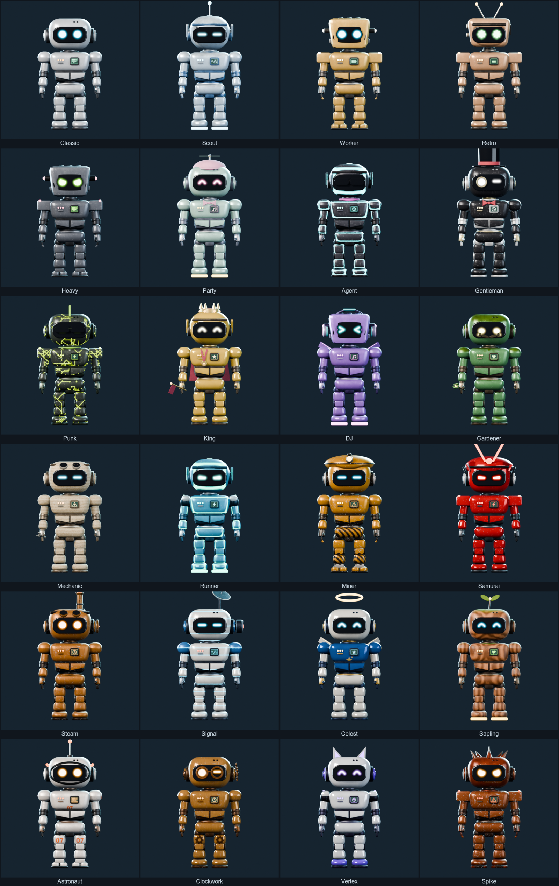
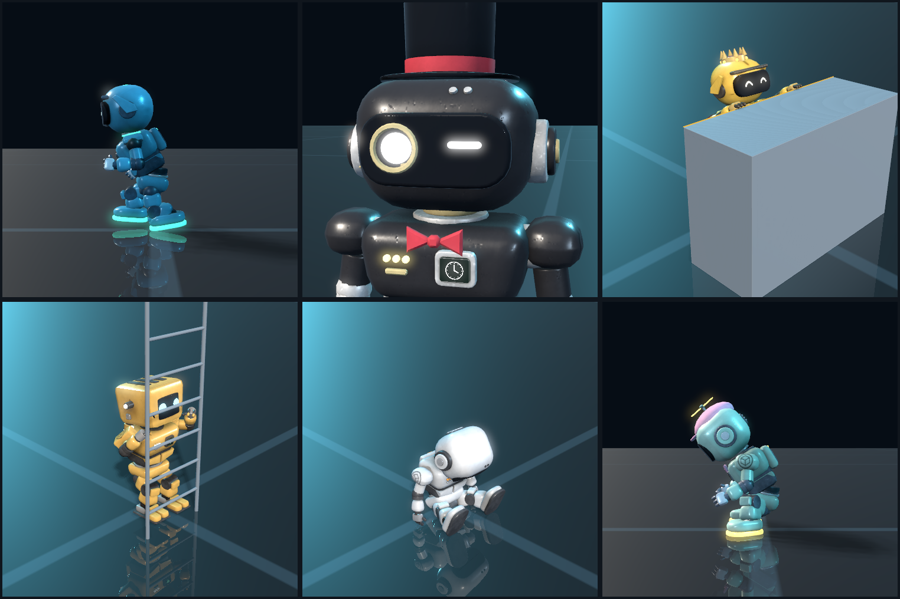

# Cube Escape – Roboter-Charakter (Generator 1.19.0)

Der spielbare Roboter aus dem Cube-Escape-Keyart, vollständig per Skript erzeugt: Geometrie mit Bauteil-Varianten
und Accessoires, Materialien, gebackene Texturen (Detail- und Ausdrucks-Texturen per ImageMagick), Rig mit Bein- und
Arm-IK, 85 Animationen, maschinenlesbare Clip-Daten fürs Spiel, automatische QA, Vorschaurender, `.blend`,
Unity-fertige `.fbx` (Standard, modular und je Robotertyp) und ein eigener **Robot Viewer** zum Anpassen: 85
Animationen in 10 Kategorien (darunter zwei Typ-Emotes), 76 Skins als Daten (Palette mit Zweitfarbe, Oberfläche,
Werkstoff, Abzeichen, Leuchtlinien, Schichten wie Rost, Moos, Frost, Glutrisse, Tarnung, Abnutzung, Spezialmaterialien
Glas, Hologramm, Glitch, Schillern, Skizze, Regenbogen, Galaxie, Körperformen facettiert, Voxel, durchbrochen und
offene Kabel), 33
Augen-Ausdrücke, 16 Display-Motive und 3 animierte, 34 Accessoires (Umhang und Antenne schwingen nach, der Schornstein
raucht), 24 Robotertypen, Skin-Bogen im Stil der Konzeptbilder und UI-Icons.
**Das Spielprojekt wurde nicht verändert** – dieser Ordner steht für sich.





## Inhalt

| Pfad | Inhalt |
|---|---|
| `output/RobotViewer.app` | **Robot Viewer** – macOS-App zum Anpassen und Ansehen (Doppelklick) |
| `data/skins.json` | **Skins als Daten** (Format `CubeEscapeRobotSkins` 1): Palette, Zweitfarben-Zonen, Oberfläche, Werkstoff, Schichten, Abnutzung, Abzeichen, Leuchtlinien, Teile, Ausdruck, Display, Stufe/Startset |
| `data/concept_palettes.json`, `docs/concepts/` | Farbpunkte der Konzeptbögen (`scripts/concept_palettes.py`) und die Bögen selbst |
| `output/CubeEscape_Robot.fbx` | Unity: Standard-Look als 1 Mesh (3 Materialien) + Rig + 85 Takes |
| `output/LOD/`, `output/Types/LOD/` | Unity: Detailstufen LOD1/LOD2 (≈ 6 000 / 2 500 Dreiecke) je FBX, gleiches Rig, ohne Takes |
| `output/CubeEscape_Robot_Modular.fbx` | Unity: alle Bauteil-Varianten und Accessoires als einzelne Meshes am selben Rig (ohne Animation) |
| `output/Types/CubeEscape_Robot_<Typ>.fbx` | Unity: jeder Robotertyp fertig kombiniert als 1 Mesh + Rig (ohne Animation, Clips aus der Haupt-FBX) |
| `output/Forms/` | Unity (1.14): Körperformen – `CubeEscape_Robot_<Form>.fbx` (Standard-Look in der Form, gleiches Rig, ohne Takes) für Faceted, Voxel, Wired, `CubeEscape_Robot_Modular_<Form>.fbx` für die Mesh-Formen |
| `output/Looks/<Typ>.robotlook.json`, `output/robot_look.schema.json` | Look je Robotertyp im Spielstand-Format (Version 2) und JSON-Schema dazu |
| `output/CubeEscape_Robot.blend` | Blender-Szene: Standard-Mesh, `Robot_Parts` (alle Teile), Rig, NLA-Spur je Animation |
| `output/robot_config.json` | Slots, Varianten, Robotertypen (mit Maßen), Skins, Ausdrücke, Display-Motive, Atlas-Zellen und **Clip-Daten** (für Unity) |
| `output/ANIMATIONS.md` | automatisch erzeugte Clip-Liste (Frames, Loop, Grundtempo, Höhe, Schritt-Frames, Unity-Hinweise) |
| `output/Textures/` | 2048² PNGs: BaseColor/Emission des Standard-Skins (die übrigen Skins sind Daten in `data/skins.json`; ihre fertigen Karten für die Vorschauen liegen seit 1.17 in `cache/skin_textures`), MetallicSmoothness, Normal, Occlusion, ColorMask, LightMask, **Masken** (Badge ×3, Line ×2, Zone ×2, Layer ×2, Material ×2), Eye-Atlas (2048 × 2560), Display-Atlas, Display-Flipbook; `Unity/T_Robot_U_*.png`: die Masken für Unity gepackt (10 statt 14 Texturen, ≤ 1024²) |
| `output/Icons/` | UI-Icons 256²: `Skins/`, `Expressions/`, `Displays/`, `Badges/`, `Accessories/` |
| `output/ViewerData/` | Daten für den Viewer (Geometrie, Rig, Animationen, Texturen) |
| `output/Previews/` | Ansichten, Typen, Skins, **Skin-Bogen** (`skin_sheet.png`), **Silhouetten**, **Gegenüberstellung** der Schichten, Werkstoffe und Abnutzung (`weathering.png`), Ausdrücke, Kontaktbögen je Phase, GIFs |
| `scripts/generate_robot.py`, `scripts/robogen/` | Generator (Blender 5.2 LTS): Einstieg und `main()`, die Schritte als 16 Module (Reihenfolge und Regeln in `robogen/__init__.py`) |
| `scripts/make_textures.py` | ImageMagick: Gebrauchsspuren, Metall, Kratzer, Decals, Abzeichen, Leiterbahnen, Blitze, 33 Augen-Ausdrücke, 16 Display-Motive, 3 animierte (Flipbook) |
| `scripts/concept_palettes.py` | einmaliges Werkzeug: Farbpunkte der Konzeptbögen auslesen (nie im Generatorlauf) |
| `scripts/export_viewer.py`, `scripts/reexport_viewer.py` | Datenexport für den Viewer (im Generator bzw. separat aus der `.blend`) |
| `scripts/profile_run.py` | Lauf unter cProfile (Profil nach `<out>/logs/profile.prof`) |
| `scripts/verify_robot.py` | unabhängige Prüfung von `.blend`, allen FBX, Konfiguration, Clip-Daten, Looks und Viewer-Daten |
| `scripts/debug_*.py`, `scripts/diag_parts.py` | Hilfen zur Fehlersuche |
| `viewer/` | Quellcode des Viewers (SwiftUI + SceneKit), `build.sh`, `test_viewer.sh` und Test-Looks in `tests/` |
| `docs/TECHNIK.md` | **Techniken und Lehren** des Generators – Übertrag auf den Cubegen-Modell-Editor |
| `unity/RobotTestbed/`, `unity/run_testbed.sh` | **Unity-Testpaket:** eigenes URP-Projekt (nie das Spiel), importiert die Ausgabe, prüft und rendert sie |
| `.agents/skills/` | Skills für Agenten: `rg-unity-testbed`, `rg-unity-integration` (`.claude/skills` verweist darauf) |
| `output/UnityTestbed/` | Bericht des Testpakets: `report.json`, `tests.xml`, Logs, Screenshots und Bögen `unity_*.png` |

## Neu erzeugen

```bash
# Teststufe: quick (≈ 10 s mit warmem Cache) beim Arbeiten, standard (≈ 1 min) vor dem Commit, full (≈ 3–4 min) für den Lieferstand
/Applications/Blender.app/Contents/MacOS/Blender -b --factory-startup --python-exit-code 1 --python scripts/generate_robot.py -- --tier quick
# danach alle Prüfungen gleichzeitig: verify_robot.py, Viewer bauen und testen, Unity-Testpaket (≈ 35 s)
scripts/check_output.sh output/_quick
```

| Stufe | Texturen | QA | Renders | Ausgabe | 1.8.0 | 1.9.0 |
|---|---|---|---|---|---|---|
| `quick` | 512, AO 16 Samples | Standard-Roboter, alle Clips, parallel | keine | `output/_quick` | 25 s | **10–11 s** (15 s neben laufendem Unity-Editor) |
| `standard` | 1024, AO 32 Samples | alle 24 Typen, alle Clips, parallel | Ansichten, Skins, Ausdrücke, Typen (¼ Samples) | `output/_standard` | 133 s | **54–68 s**; 1.13.1 mit QA-Cache 51 s (vorher 121 s) |
| `full` | 2048, AO 64 Samples | alle 24 Typen, alle Clips, parallel | alles inkl. Animationsbögen und GIFs | `output` | 655 s | **211 s** |

Gemessen am 12.10.2026 auf dem Apple M5 (4 Performance- + 6 Effizienzkerne, 8 GPU-Kerne), ruhige Maschine, warmer
Cache; 1.7.0 brauchte rund 40 min. Jeder Lauf schreibt Schrittzeiten, Systemlast zu Beginn und Ende, Prozess-Sekunden
je Paketart und eine Statistik je Worker nach `logs/robot_report.json` (`timings`). **Zeitband (1.17):** Bewertet
wird gegen den Median früherer ruhiger Läufe derselben Stufe und Cache-Lage (`cache/timings.json`, warm = Bake aus
dem Cache, nichts gerendert, keine Clips gemessen): Last zu Beginn unter 0,3 je Kern = ruhig, Toleranz 30 %; unter
0,8 je Kern = leicht, Toleranz × 2,6; darüber = schwer, „NOT JUDGED“. Nur ruhige Läufe werden Referenz, die ersten
drei melden „NO REFERENCE YET“. Das Stufenbudget (`TIERS`: 20 / 90 / 300 s) bleibt als Ziel im Bericht. Ein
paralleler Unity- oder Blender-Lauf (z. B. eines anderen Agenten) macht jeden Schritt zwei- bis fünfmal langsamer.

**1.17 „Slimline“:** mit warmem Cache `quick` 22 s → 9–12 s, `full` 90–115 s → 54–59 s (FBX, Viewer-Daten und Clip-Daten werden nur bei
geänderten Eingaben neu geschrieben, siehe unten).

### Ablauf und Worker

1. Hauptprozess: ImageMagick-Quelltexturen, Materialien, Geometrie, UVs (Cache).
2. **QA-Worker starten** – sie brauchen nur Geometrie und Animation und rechnen, während der Hauptprozess backt.
3. Hauptprozess backt (GPU), danach **Render-Worker starten**: Sie bauen das Modell ohne Backen neu, nehmen die UVs
   aus dem Cache des Hauptlaufs und laden dessen gebackene Texturen (`--use-textures`).
4. Hauptprozess: Rig, Animationen, Clip-Daten, FBX-Export, Viewer-Daten – der kritische Pfad; die Worker laufen
   deshalb mit `nice 10`.
5. Danach arbeitet der Hauptprozess selbst Pakete ab, sammelt die Ergebnisse in fester Reihenfolge, montiert die
   Bögen (parallel) und speichert die `.blend`.

**Arbeitspakete** (`make_jobs`, Warteschlange `logs/jobs`): QA je Robotertyp und Clip-Gruppe (große Gruppen geteilt,
damit auch die Schnellstufe mit nur Classic parallel läuft); Ansichten, Skins, Ausdrücke und Typen in Blöcken;
Animationsbögen je Clip (der Worker schreibt die zwei Bogenzeilen und meldet sie als JSON zurück), GIFs je Clip.
Wer frei ist, beansprucht das nächste Paket (größte zuerst) über eine exklusiv angelegte Datei; Render-Worker
helfen danach bei der QA. Die Ergebnisse hängen nicht davon ab, wer was gerechnet hat (QA-Bericht identisch mit 1.8.0).

**Prozesse:** `--workers` (Standard Kerne − 1 = 9), davon `--render-workers` (Standard 3) für Renders; die
Schnellstufe startet nur so viele QA-Worker, wie sich lohnen (≥ 600 QA-Frames je Worker, sonst kostet der Start
von 2 s mehr, als er spart). QA-Worker laufen mit `-t 1`, Render-Worker mit `-t 2`. `--workers 0` rechnet alles im
Hauptprozess (gleiches Ergebnis).

### Was die Zeit spart

- **Testzeit (1.13.1):** QA-Ergebnisse je Typ und Clip im Cache (`cache/qa`; Schlüssel = Mesh mit kanonischer
  Topologie, Rig, Clip-Schlüssel, Quelltext der QA-Funktionen) – ohne Geometrie- oder Animationsänderung entfällt die
  QA fast ganz; Typ-FBX und ihre LODs als parallele Arbeitspakete der Render-Worker; alle Bögen (Icons, Skin-Bogen,
  Gegenüberstellung, Kontaktbögen) in einem Thread-Pool; `scripts/check_output.sh` prüft Verify, Viewer und Unity
  gleichzeitig; der Viewer kompiliert nur bei geänderten Quellen (beide Architekturen parallel), die Round-Trip-Tests
  laufen zu sechst; das Unity-Testpaket braucht einen Unity-Start (siehe Unity-Testpaket).
- **Render-Cache (1.13.3):** jedes Vorschaubild wird unter einem Abdruck dessen gespeichert, was die Kamera sieht
  (Objekte, Pose, Materialwerte, Texturinhalte, Licht, Kamera, Einstellungen) – unveränderte Bilder kommen aus
  `cache/render`, auch wenn sich Generator-Code geändert hat; eine geänderte Skin-Farbe rendert nur deren Bilder neu.
  Ungenutzte Einträge (QA wie Render) werden nach 7 Tagen gelöscht, `--no-cache` rendert alles.
- **Ausgaben-Cache (1.17):** Haupt-FBX samt LODs, Modular-FBX, Form-FBX und Viewer-Daten bleiben liegen, wenn ihr
  Abdruck gleich ist (`cache/outputs.json`: Meshes in kanonischer Reihenfolge mit UVs und Materialien, Rig, Clips,
  Quelltext der Export-Funktionen; eine fehlende oder in der Größe geänderte Datei wird neu geschrieben). Clip-Daten
  je Clip in `cache/clips`, gemischte Skin-Karten nur bei geänderter Palette (`cache/skin_textures/stamps.json`).
  Log: „unchanged outputs kept: …“, „clip data: N clips from the cache“, „composed N of 76 skins“. Zur Fehlersuche
  schreibt `ROBOT_OUTPUT_DIGEST_DUMP=<Datei>` die Abdrücke je Objekt.
- **Viewer-Daten (1.17):** Ecken je Teil zusammengefasst (gleiche Position, Normale, UV, Gewichte → ein Vertex),
  `vertices.bin` rund dreimal kleiner.

- **Skins werden nicht einzeln gebacken.** Jede Körperfarbe hängt linear von der Palette ab: eine Konstante plus
  eine Graustufen-Gewichtskarte je Palettenfarbe. Sechs Backs liefern diese Ebenen, jeder Skin entsteht daraus per
  numpy. Das ist exakt: Der Volllauf backt den Standard-Skin zusätzlich direkt und vergleicht (Abweichung 4e-7,
  Abbruch ab 2e-3). Weitere Skins kosten damit fast nichts.
- **Ein Objekt pro Back.** Cycles backt jedes ausgewählte Objekt in einer eigenen Sitzung, und auf Metal kostet
  jede eine Geräte-Synchronisation (35 Teile: 9–20 s je Durchgang). Gebacken wird deshalb eine zusammengefügte
  Kopie aller Teile, für die AO eine je Konfiguration: 0,2–1 s je Durchgang, Backen gesamt 50 s statt 24 min.
- **Cache** in `<out>/cache`: UVs (Blenders Insel-Packen ist nicht deterministisch; gespeichert in einer Ecken-
  Reihenfolge, die nicht von der wechselnden Flächenreihenfolge abhängt), AO (hängt nur von Geometrie, UVs und dem
  Bake-Code ab) und alle Bake-Ebenen (zusätzlich Materialien und Quelltexturen). ImageMagick-Texturen entstehen
  parallel und werden bei unverändertem Skript wiederverwendet. `--no-cache` liest keinen Cache (die UVs werden
  trotzdem geschrieben, die Render-Worker brauchen sie).
- **Vorschau-Schnellmodus.** Gemessen mit macOS `sample`: Ein EEVEE-Render wartete zu ~95 % in
  `ShadowModule::shadow_update_finished`, zweimal je Sample – einmal davon nur, weil das additiv-transparente
  Augenmaterial (`BLENDED`) die Forward-Pipeline erzwingt. Skins, Typen, Animationsbögen und GIFs rendern deshalb
  mit deckenden Augen (Visier-Shading plus dasselbe Leuchten, freigestellt wo der Atlas schwarz ist) und ohne
  Raytracing: 0,46 → 0,16 s je Bild bei gleichem Bild in Vorschaugröße. Die Auflösung kostet dagegen kaum etwas
  (150 px 0,34 s, 600 px 0,44 s). Ansichten (inkl. Hero) und Ausdrücke bleiben exakt; die `.blend` behält das
  Original-Material. Animationsbögen und GIFs mit 12 Samples.
- **GPU und Neural Engine:** Ein einzelner EEVEE-Prozess hält die GPU schon zu ~85 % beschäftigt (`ioreg`,
  `Device Utilization %`), 4 Prozesse zu 90–99 % – mehr als 3 Render-Worker lohnen nicht. Metal verteilt die Arbeit
  selbst auf alle GPU-Kerne. Die Neural Engine nutzt Blender nicht.
- **QA:** Kollisionsbäume nur für Teilepaare, deren Hüllquader sich berühren – der Test läuft für alle Paare eines
  Frames in einem numpy-Aufruf; Koordinaten werden als `float32` gelesen (natives Format, 3× schneller). Eine QA
  aller 14 Typen (1.9) kostet in einem Prozess 245 s, mit 9 Workern rund 72 s: Mehr als Faktor 3,4 geben 4 Performance-
  und 6 Effizienzkerne unter Volllast nicht her.
- **ImageMagick mit `MAGICK_THREAD_LIMIT=1`:** parallele Aufrufe bremsten sich über ihre OpenMP-Threads gegenseitig
  aus (Montage aus 28 Kacheln 3,8 → 1,6 s); die Texturen bleiben bitgleich.

### Neural Engine – geprüft (1.9.2), kein Einsatz

Der Fahrplan schlug vor, Typ × Skin × Ausdruck mit Apples Vision-Merkmalsvergleich (Feature Prints auf der Neural
Engine) gegen Referenzbilder zu prüfen. Gemessen am 12.10.2026 mit Renderpaaren bekannten Inhalts (300 px,
24 Samples, Abstand zum Referenzbild):

| Unterschied | Feature Print | Pixel-RMSE |
|---|---|---|
| gleiches Bild aus einem zweiten Prozess (Rauschen) | 0,003 | 0,00001 |
| 12 statt 24 Samples (nur Qualität) | 0,061 | 0,0057 |
| ein Animationsframe weiter (legitim) | 0,030 | 0,0082 |
| schnelle Vorschau-Augen (nur Darstellung) | 0,073 | 0,011 |
| anderer Ausdruck | 0,074 | 0,025 |
| **fehlende Hand (Fehler)** | **0,106** | 0,0095 |
| anderer Skin | 0,26–0,28 | 0,024–0,036 |

- **Kein Rauschen auszugleichen:** Die Renders sind über Prozesse hinweg praktisch bitgleich (der UV-Cache hält auch
  die Texturen fest); jede echte Änderung liegt beim Pixelvergleich über 500-mal über dem Rauschen. Ein exakter
  Vergleich (`magick compare`, 18 ms je Paar) genügt.
- **Kein besseres Urteil:** Der Feature Print trennt einen Fehler (fehlende Hand 0,106) kaum von einer reinen
  Qualitätsänderung (0,061); er sagt „anders“, nicht „falsch“ – wie der Pixelvergleich.
- **Nicht reproduzierbar:** Dasselbe Bildpaar ergibt auf der Neural Engine 0,0026, auf der CPU 0,0003; Grenzwerte
  würden je Gerät und macOS-Version kippen. Als Prüfschranke ungeeignet.
- **Tempo ist kein Argument:** Neural Engine 3,8 ms je Bild (GPU 15,8 ms, CPU 35,4 ms) – gegenüber 160–460 ms für
  den Render selbst unerheblich. Blender, Cycles, EEVEE und der FBX-Export nutzen die Neural Engine nicht.
- **Bildgenerator für Vorlagen** (zweiter Vorschlag, nicht installiert: mehrere GB Modell): Die Vorlagen entstehen
  heute reproduzierbar per ImageMagick im Low-Poly-Stil und hängen im Cache-Schlüssel; ein Bildgenerator liefert
  das nicht und bräuchte eine Lizenz- und Stilprüfung. Kein Einsatz geplant.

Messen statt raten: `scripts/profile_run.py` startet einen Lauf unter cProfile (mit `--workers 0` sind auch die
Pakete im Profil):

```bash
/Applications/Blender.app/Contents/MacOS/Blender -b --factory-startup --python-exit-code 1 --python scripts/profile_run.py -- --tier quick --workers 0
```

```bash
/Applications/Blender.app/Contents/MacOS/Blender -b output/CubeEscape_Robot.blend --python-exit-code 1 --python scripts/verify_robot.py -- --out output
```

```bash
viewer/build.sh
```

```bash
viewer/test_viewer.sh
```

Weitere Optionen (überschreiben die Stufe): `--out`, `--tex-size 1024`, `--ao-samples 32`, `--no-render`,
`--no-anim-sheets`, `--groups Phase1,Phase4` (nur diese Clips), `--qa-types Runner,King` (QA nur für diese Typen,
Classic immer), `--skip-bake` (ohne Texturen), `--no-cache`, `--check-compose`, `--bake-device cpu|gpu`,
`--workers 4`, `--render-workers 2`. Benötigt ImageMagick 7 und für den Viewer die Xcode-Kommandozeilenwerkzeuge.
Regeln für Agenten (Prüfablauf, Cache, Worker): [AGENTS.md](AGENTS.md); Versionen: [CHANGELOG.md](CHANGELOG.md);
Fahrplan: [docs/FAHRPLAN.md](docs/FAHRPLAN.md); Techniken und Lehren (für Cubegen): [docs/TECHNIK.md](docs/TECHNIK.md).

## Robot Viewer

`output/RobotViewer.app` öffnen (beim ersten Start ggf. Rechtsklick → Öffnen, die App ist nur lokal signiert).

- **Robotertyp:** Classic, Scout, Worker, Retro, Heavy, Party, Agent, Gentleman, Punk, King, DJ, Gardener, Mechanic,
  Runner (schmalste Silhouette); seit 1.12 Miner, Samurai, Steam, Signal, Celest, Sapling, Astronaut, Clockwork,
  Vertex, Spike – fertige Looks auf Knopfdruck, „Zufall“ würfelt einen. Gentleman und King haben ein eigenes Emote
  (HatTip, FlagWave).
- **Bauteile:** Kopf (Classic, Dome, Boxy, TV), Hände (Mitt, Claw), Füße (Boots, Round, Mech), Schulterpanzer
  (Round, Slim, Square), Rucksack (Classic, Battery).
- **Accessoires (34):** Kopf (Antenne – schwingt nach, Propellermütze – Propeller dreht sich, Kopfhörer, Zylinder,
  Krone, Irokese; 1.12: Grubenhelm mit Stirnlampe, Samurai-Helm, Stacheln, Ohren, Satellitenschüssel, Schornstein mit
  Rauch, Heiligenschein, Blattspross), Gesicht (Sonnenbrille, Monokel, Schnurrbart, Schutzbrille; 1.12: Linsenringe,
  Helmring), Ohren (1.12, am linken Ohr: Linsenauge, Zahnräder, Zifferblatt), Hals (Fliege, Schal, Medaille,
  Glöckchen), Rücken (Jetpack, Umhang – schwingt nach, Flügel; 1.12: Rucksack mit Taschen), Hand (Schraubenschlüssel,
  Blume, Fahne – in Kletter-/Hänge-Clips automatisch ausgeblendet).
- **Farben:** 76 Skins als Startpunkt (★ = Startset), Thema darunter; ein Skin setzt Farben, Oberfläche, Zweitfarbe,
  Abzeichen und Leuchtlinien, Retro/Orbit/Tank auch eigene Teile. Danach frei: Panzerung, Mechanik, Metall, Lichter,
  Augen, Display, Visier, Stoff; Oberfläche Standard/Matt/Satin/Glanz/Candy/Chrom.
- **Spezialmaterial (1.13):** Glas/Kristall, Hologramm (wandernde Scanlinien), Glitch, Schillern, Skizze, Regenbogen
  und Galaxie (animiert) mit zwei Farben, Stärke und Tempo; Wirkung zur Laufzeit über dem Skin, Visier und Lichter
  bleiben. Die Beschreibung fürs spätere URP-Material steht in `robot_config.json` › `specials` (`urp`).
- **Form (1.14):** Grundform, Facettiert (Origami, Geo), Voxel (Pixel), Durchbrochen (Bone) oder Offene Kabel (Wire);
  der Skin bringt seine Form mit, jede Form passt zu jedem Skin.
- **Zweitfarbe:** Farbe und Lackzonen (Kopf, Ohren, Brust, Schultern, Arme, Hüfte, Beine, Füße).
- **Abzeichen:** bis zu zwei mit eigener Farbe – Warnstreifen, Kreuz, Wolke, Nummer, Biohazard, Schriftzeichen,
  Rennstreifen, Zielmarke, Stern, Zahnrad, Blatt (Ohrscheibe, Brust, Schulter, Oberschenkel, Rücken, Hinterkopf je nach
  Abzeichen). Der Viewer packt die beiden gewählten Abzeichen in eine Textur – beliebig viele Abzeichen-Masken.
- **Leuchtlinien:** Leiterbahnen, Ringe, Kanten, Blitze, Gelenke mit Farbe und Stärke.
- **Werkstoff:** Holz, Stein (mit Gravurbändern), Sand, Papier, Beton, Messing, Platine – Muster auf der Panzerung mit
  eigener Musterfarbe und eigener Rauheit; beim Wählen wird eine passende Panzerfarbe gesetzt.
- **Schichten:** Rost, Moos, Frost, Glutrisse (leuchtend), Tarnung je mit Regler 0–1 (= bedeckter Anteil der Fläche)
  und Farbe; **Abnutzung** 0 sauber, 0,5 wie gebacken, 1 verbeult.
- **Augen:** 33 Ausdrücke (Normal, Happy, Excited, Love, Angry, Sad, Sleepy, Surprised, Skeptical, Confused, Wink,
  Focused, Glitch, Pixel, Off, Cute, Laugh, Crying, Shy, Dollar, Question, Exclaim, Loading, LookLeft, LookRight,
  Determined, Sleeping, Target; 1.10: Damage rot, LowPower gedimmt, Check, Warning orange, Blink), Leuchtkraft; optional
  passt sich der Ausdruck der Animation an, dann blinzelt der Roboter auch (alle 2,5–6 s, `robot_config.json` › `blink`).
- **Brust-Display:** 16 Motive (Status, Heart, Battery, Smiley, Wave, Cube, Hello, Music, Lightning, Warning, Thermo,
  Clock, Signal, Star, Planet, Loading) und 3 animierte (Heartbeat, Spinner, Talk); optional passend zur Animation.
- **Animation:** alle 85 Clips nach Kategorien, Play/Pause (Leertaste), Zeitleiste, Tempo, Wiederholen. Unter dem Clip
  stehen seine Spieldaten (Grundtempo, Höhe, Root Motion, Schritt-Frames, aktuelles Ereignis). Augen, Display,
  „Strom“ (Death schaltet ab, Respawn an) und ausgeblendete Hand-Gegenstände kommen aus den Clip-Daten.
- **Hilfsobjekte:** Kante, Stange, Leiter, Kiste, getragene Kiste oder Ventilrad (1.19) an der Stelle, die der Clip voraussetzt – damit sieht man, ob
  Hände und Füße wirklich greifen.
- **Ansicht:** Iso, Front, Side, Back, Face, Drehteller, Boden; Maus/Trackpad dreht und zoomt.
- **Look laden/speichern** (`*.robotlook.json`, Version 6; Versionen 1 bis 5 werden übernommen, unbekannte Teile/Namen
  durch Standardwerte ersetzt und gemeldet), **Screenshot** (1600 × 1600 PNG), **GIF** (15 fps, 600 px) und **Video**
  (MP4, 30 fps, 1080 px) der laufenden Animation.
- **Vergleich A/B:** „Als B merken“ stellt den aktuellen Look rechts daneben (gleicher Clip, gleiche Ansicht),
  „Tauschen“ wechselt die Seiten.
- Universal-App (Apple Silicon und Intel), ab macOS 13.

Für automatische Tests rendert die App auch ohne Fenster:

```bash
output/RobotViewer.app/Contents/MacOS/RobotViewer --snapshot /tmp/robot.png --type Party --anim DanceRobot --frame 30 --view Front
```

Weitere Schalter: `--look datei.json`, `--save-look out.json` (schreibt den geladenen, ggf. migrierten Look),
`--skin` (mit `--skin-parts` samt Teilen), `--form` (1.14), `--expression`, `--display`, `--finish`, `--variant Slot=Variante`,
`--size 1000x1000`, `--no-floor`, `--no-props`, mit `--anim` auch `--gif clip.gif` oder `--video clip.mp4` (ganzer
Clip). `viewer/test_viewer.sh` nutzt das für Migrations-, Form-, Round-Trip- und Export-Tests. `--sidebar-check out.png [--type …]` prüft, ob
der Inhalt der Seitenleiste in seine Spalte passt; `--window 1710x1000` öffnet das Fenster in dieser Größe.

## Kennzahlen

| | |
|---|---|
| Höhe | 1,38 m (Classic-Kopf, seit 1.14; vorher 1,30 m), steht auf z = 0, Ursprung zwischen den Füßen |
| Standard-Mesh | 11 852 Dreiecke, starres Skinning, 3 Materialien (Körper-Atlas, Augen, Display) |
| Modular | 35 Teil-Objekte: `Robot_Body` + je Slot/Variante, gemeinsamer Textur-Atlas |
| Je Robotertyp | 1 Mesh, 3–4 Materialien (Fabric nur bei Stoff-Accessoires), Maße in `robot_config.json` › `typeBounds` |
| Bones | 30: Root, Pelvis, Spine, Head, Eyes, Shoulder/UpperArm/LowerArm/Hand/Fingers/Thumb/Prop _L/_R, UpperLeg/LowerLeg/Foot _L/_R, Socket_Head/Neck/Back, Federknochen Cape und Antenna (1.12) |
| Achsen | Blender: Blick −Y, links = +X. FBX: Forward Z, Up Y → Unity Blick +Z (seit 1.10.1, im Unity-Testbett gemessen) |

## Anpassbarkeit – wie es technisch funktioniert

- **Varianten:** Jedes Bauteil hängt starr an genau einem Bone; alle Varianten nutzen dieselben Gelenkpunkte. Darum
  funktionieren alle 85 Animationen mit jeder Kombination – die QA prüft jeden der 24 Robotertypen gegen jeden Clip
  (Typ-Emotes nur mit ihrem Typ). Jeder Aufsatz steckt in mindestens einem Typ, so ist er in allen Clips geprüft.
- **Farben ohne neue Texturen:** `T_Robot_ColorMask.png` – R Panzerung, G Mechanik, B Metall; `T_Robot_LightMask.png`
  – Lichter; Rest auf Körper-Flächen = Visier. Ein Shader färbt mit `Farbe × Helligkeit(Albedo) / Helligkeit(Classic-Farbe)` um; Schmutz,
  Kratzer, AO und Decals bleiben erhalten. Fertige Karten je Skin (`T_Robot_BaseColor_<Skin>.png`) entstehen für die Vorschauen in `cache/skin_textures`; geliefert wird nur der Standard-Skin.
- **Schichten, Werkstoffe, Abnutzung (1.11):** gebackene Felder in `T_Robot_LayerMask*` (Rost, Moos, Frost,
  Glutrisse / Tarnung, Kratzer, Schmutz) und `T_Robot_MaterialMask*` (sieben Werkstoff-Muster), Zuordnung in
  `robot_config.json` › `layers`, `materials`, `weathering`. Die Schichtfelder sind auf die Lackfläche normiert
  (Rangfolge über ein Histogramm): Stärke a bedeckt den Anteil a, `cover = clamp((Feld − (1 − a)) / 0,1, 0, 1)`. Rost sitzt in Ecken und
  Fugen, Moos oben und in Fugen, Frost oben und an Kanten, Glutrisse folgen einem Rissnetz (verkohlt, Adern leuchten),
  Tarnung sind zwei Schwellen eines Fleckenfelds. Werkstoff: `mix(Musterfarbe · r, Farbe, Muster)` auf der Panzerung.
  Reihenfolge: Zweitfarbe → Abnutzung → Werkstoff → Abzeichen → Rost/Moos/Frost → Tarnung → Glutrisse → Leuchtlinien
  (die Abnutzung zuerst, damit „sauber“ keine Werkstoff- oder Schichtmuster übermalt).
- **Skins = Daten (1.10):** Zweitfarbe, Abzeichen und Leuchtlinien kommen aus Masken (je Kanal eine ID, Zuordnung in
  `robot_config.json` › `badges`, `linePatterns`, `zones`). Reihenfolge im Shader: Grundfarben → Zweitfarbe
  (`mix(c, armor2 · r, Zone)`) → Abzeichen (`mix(c, Abzeichenfarbe · r, Maske)`) → Leuchtlinien (Albedo
  `c · (1 − m · 0,85) + m · 0,85 · 0,6 · Farbe`, Emission `+ Farbe · m · Stärke`), mit
  `r = clamp(Helligkeit(Albedo) / (R · Helligkeit(Panzerung) + B · Helligkeit(Metall)), 0,2, 1,6)` aus der Farbmaske.
  Die Masken sind mit der Farbmaske vormultipliziert; Lackzonen schließen einander aus. Herleitung und Lehren:
  [docs/TECHNIK.md](docs/TECHNIK.md).
- **Augen und Display:** eigene kleine Flächen mit eigenem Material. Der Ausdruck/das Motiv ist eine Zelle im Atlas
  (`robot_config.json` → `atlasCells`: Scale/Offset in UV, Ursprung unten links). Augen werden additiv gezeichnet;
  der weiche Glow steckt im Atlas.
- **Stoff-Accessoires:** Material `M_RobotFabric` = Körper-Atlas × Stofffarbe.
- **Zylinder:** Krempe und Hut sind glänzend schwarz wie das Visier (bei jedem Skin), das Hutband hat die Stofffarbe.
- **Sockets:** `Socket_Head`, `Socket_Neck`, `Socket_Back` (Accessoires), `Prop_L/R` (Werkzeuge in der Hand).
- **Nachschwingen (1.12):** Umhang und Antennenstab hängen an Federknochen (`Cape`, `Antenna`). Der Generator rechnet
  je Clip eine gedämpfte Feder (Punktmasse an der Knochenspitze, Ruhelage zur Schwerkraft geneigt, Fahrtwind in den
  Lauf-Clips) und backt das Ergebnis als Knochenkurven – im Spiel läuft keine Physik. Begrenzt auf „weg vom Körper“,
  Loops schließen ohne Sprung (`SPRINGS`, `CLIP_WIND`).
- **Typ-Emotes (1.12):** `robotTypes[].emote` – Gentleman `HatTip` (der Hut gleitet zur Hand und reitet beim
  Verbeugen auf ihr, `ATTACHMENTS`), King `FlagWave` (Fahne bleibt sichtbar). Ein Typ-Emote gehört zu seinem Typ:
  QA und Spiel nutzen es nur mit dessen Kopf-/Hand-Accessoire.
- **Partikel-Emitter (1.12):** `robot_config.json` › `emitters` (Schornsteinrauch: Socket, Position, Richtung im
  Charakterraum); der Viewer zeigt den Rauch, das Spiel setzt dort ein Partikelsystem an.
- **Spezialmaterialien (1.13):** Laufzeit-Effekt über dem fertigen Skin (`robot_config.json` › `specials`, Skin-Feld
  `special`): Glas (Tönung, Alpha 0,35 → 0,95 am Rand, Randglanz), Hologramm (Leuchten mit Fresnel, 40 Scanlinien je
  Meter), Glitch (12 Bänder je Meter, Zufall je Band und Takt), Schillern (Farbton aus Blickwinkel und Höhe),
  Skizze (Papier, Tuschekontur, Schraffur im Dunkeln), Regenbogen und Galaxie (animiert, nur Panzerung). Visier und
  Lichter bleiben. Gebacken wird nichts; ohne Effekt zeigt der Skin seine Palette.
- **Proportionen (1.14):** Die Teile werden im alten Maß gebaut und danach je Knochen umgeformt (`PROPORTIONS`):
  Kopf breiter (× 1,14) und höher (× 1,24), Arme, Hände und Beine kräftiger, Rumpf und Becken breiter; Gelenke,
  Clips, IK-Ziele und Bodenkontakte bleiben unverändert. Schulterpanzer und runde Füße behalten ihr Maß (sonst
  stoßen sie an den Kopf bzw. den Oberschenkel). Fugen und Schrauben auf Beinen, Hüfte und Brust.
- **Körperformen (1.14):** `robot_config.json` › `forms`, Skin- und Look-Feld `form`. *Mesh-Formen* sind eigene
  Teil-Objekte mit demselben Rig, denselben Materialien und dem Textur-Atlas (jeder Skin passt): Facettiert = Decimate
  „Collapse“ auf 16 % mit flachen Facetten (seit 1.17 innerhalb der Grundform), Voxel = Würfel von 3 cm im Weltraster (eine Zelle zählt, wenn ihr
  Mittelpunkt mindestens eine halbe Zelle tief im Teil liegt – so ragt kein Würfel über die Grundform hinaus; jede
  Würfelseite übernimmt UV und Material des nächsten Originalpunkts, ist also einfarbig; seit 1.17 werden
  gleich aussehende Nachbarseiten zu Rechtecken zusammengefasst – Farbe, Masken und Werkstoff am Texel gleich –,
  ein Drittel weniger Dreiecke bei gleichem Bild). Gelenkkugeln, Finger und
  dünne Teile (Schrauben, Ringe) bleiben glatt, Visier und Bildschirme ebenfalls. *Shader-Form* Durchbrochen:
  runde Löcher in der Panzerung im UV-Raum (`perforation`: Abstand 4,5 cm, Radius 0,33 Zelle, jede zweite Reihe
  versetzt; im Viewer `discard`, in Unity `clip`, Innenseiten sichtbar). *Teile-Form* Kabel: Gruppe `Form_Wired`
  (Kabelstränge an Armen, Beinen, Hals, Bauch, je Knochen starr).
- **Detailstufen und Treffer-Kapseln (1.13):** LOD1/LOD2 je FBX (Decimate „Collapse“, Teile bleiben starr an ihren
  Knochen); `hitCapsules`: 15 Kapseln (Becken, Rumpf, Kopf, Arme, Hände, Beine, Füße) im Charakterraum der Ruhepose,
  Radius = 93. Perzentil des Abstands zur Knochenachse, je Kapsel die Abdeckung ihrer Vertices.

## Animationen

85 Clips in zehn Kategorien nach Inhalt (`robot_config.json` › `clipCategories`, Clip-Feld `category`; seit 1.16 –
die Bau-Phasen `group` bleiben für Kontaktbögen und QA-Pakete), vollständige Liste mit Frames, Grundtempo, Höhe,
Schritt-Frames und Unity-Hinweisen in `output/ANIMATIONS.md`:

- **Gehen & Laufen:** Idle, Walk, WalkStart, WalkStop, Run, RunFast (≈ 3,0 m/s), Sprint (≈ 4,2 m/s),
  TurnLeft/TurnRight (Root Motion), MudWalk, SlopeSlide; **im Spieltempo (1.19):** Jog (5 m/s), SprintFull (8 m/s,
  zwei Doppelschritte), StrafeLeft/StrafeRight (5 m/s, Hüfte in Laufrichtung, Blick zur Kamera), RunBack (5 m/s),
  Wade (4 m/s, durch knie- bis hüfttiefes Wasser)
- **Springen & Fallen:** Jump, DoubleJump, Fall, Land, LandRoll (1.19: Vorwärtsrolle nach tiefem Fall, `Impact` beim
  Aufsetzen)
- **Ducken & Kriechen:** Crouch, CrouchWalk (≈ 0,31 m/s), CrouchDeep (Oberkante ≈ 1,05 m), **CrawlIdle** und
  **Crawl** (1.16, Robben in Bauchlage, Oberkante ≈ 0,57 m – unter der Duck-Kapsel 0,65 m; ≈ 0,30 m/s, gemessen an den
  aufliegenden Händen; gehaltene Gegenstände ausgeblendet), **CrawlFast** (1.19: auf Händen und Knien, 2,4 m/s,
  Oberkante ≈ 0,58 m)
- **Klettern & Hängen:** LedgeGrab, HangIdle, ShimmyLeft, ShimmyRight, HangSwing, ClimbUp (Root Motion), LadderUp,
  LadderDown (in-place, Controller steigt ≈ 0,28 m/s), Vault. Die Hände greifen per **Arm-IK** feste Punkte: Kante mit
  Oberseite 1,20 m über Root und Vorderkante 0,22 m vor Root, Griffe bei ±0,35 m; ClimbUp endet 1,20 m höher und
  0,36 m weiter vorn auf der Kante. HangSwing hängt an einer Stange vor dem Gesicht (die Arme reichen nicht über den
  großen Kopf), die Leiter wird an den Holmen (±0,33 m, 0,27 m vor Root) gegriffen.
- **Interaktion & Werkzeuge:** Interact, PickUp, Push, PushStart, PushStep, ToolAim, ToolUse, Scan (Oberkörper-Maske),
  TerminalTyping, PortalEnter; CarryIdle und CarryWalk (1.19, 0,8-m-Stahlkiste vor der Brust, 5 m/s), Crank (1.19,
  Ventilrad mit beiden Händen, 1,5 s)
- **Treffer & Gefahren:** Hit (additiv nutzbar), HitHeavy, Electrocuted, GasCough, Death, Respawn, Knockback (1.19,
  zurückgeschleudert und gefangen)
- **Warten & Charakter:** IdleScratch, IdleFootTap, IdleYawn, Talk, Listen, EdgeBalance, Celebrate
- **Gesten:** Wave, Bow, Clap, Think, Point, Shrug, NodYes, ShakeNo; Typ-Emotes HatTip (Gentleman) und FlagWave (King)
- **Sitzen & Schlafen:** SitDown, SitIdle, Sleep
- **Tänze (120 BPM):** DanceBob, DanceRobot, DanceWave, DanceShuffle, DanceDisco, DanceSpin (Root Motion),
  DanceMoonwalk, DanceSway

### Clip-Daten fürs Spiel (`robot_config.json` › `clips`)

Alles, was das Spiel neben den Knochenkurven braucht, ist gemessen bzw. als Daten hinterlegt. Koordinaten im
Charakterraum `[rechts, oben, vorn]` in Metern (= Unity-Local-Space), Winkel in Grad, Frames bei 30 fps:

| Feld | Inhalt |
|---|---|
| `naturalSpeed` | Grundtempo eines In-place-Clips. Animator-Tempo = Spielgeschwindigkeit / `naturalSpeed`. Seit 1.19 gibt es Clips für die Spieltempi selbst (Tempo 1): Jog/Strafe/RunBack/CarryWalk 5, SprintFull 8, Wade 4, CrawlFast 2,4 m/s – ein gesetzter Kontakt läuft dort in jedem Frame genau mit diesem Tempo (`verify_robot.py` prüft jeden Schritt) |
| `footsteps`, `feet` | Frames mit Fußaufsatz (für Schritt-Sounds/Staub) und Bodenkontakt-Bereiche je Fuß |
| `events` | Ereignisse wie `TakeOff` (Jump 10), `Press` (Interact 19), `Thud` (Death 37), `Clap`, `Grab`, `Arrive` |
| `eyeHeight` (oberste Ebene) | Augenhöhe in der Ruhepose (1.16: 1,161 m) für die Ego-Kamera |
| `gait` | Gangart (1.16): `feet`, bei Crawl `hands` – dann beschreiben Kontakte, `footsteps` und `naturalSpeed` die Hände |
| `servo` | Servo-Geräusche (1.13): `[Frame, Gruppe, Stärke 0–1, Dauer]` je Bewegungsansatz von Kopf, Rumpf, Armen, Beinen – aus der Gelenkgeschwindigkeit gemessen |
| `rootMotion` | Weg (`move`) und Drehung (`turnRight`) vom ersten zum letzten Frame |
| `height` | kleinste/größte Körperhöhe im Clip (Kapselhöhe beim Ducken, Sitzen, Hängen) |
| `hands` | Fingergelenke L/R je Frame (Kletter-, Hänge-, Schiebe-, Trage- und Kurbel-Clips) – zum Ausrichten an Kanten |
| `prop` | Geometrie, die der Clip voraussetzt (Kante, Stange, Leiter, Kiste; 1.19: `crate` mit `size`, `forward` = Vorderseite, `bottom` – die getragene Kiste hängt fest am Root; `wheel` mit `up`, `forward` = Radebene, `radius`) |
| `expression`, `display` | Augen-Ausdruck und Display-Motiv über die Zeit (`$base` = gewählter Look) |
| `emission` | „Strom“-Faktor für Augen, Display und Lichter (Death → 0, Respawn fährt hoch, Electrocuted flackert) |
| `hideHeldItem` | Hand-Gegenstand ausblenden (Klettern, Hängen, Think, Wave, Clap, PickUp, TerminalTyping, Vault, EdgeBalance, HatTip, Kriechen, Tragen, Crank, LandRoll) |

## Unity-Testpaket

```bash
unity/run_testbed.sh
```

Ein eigenes, sonst leeres Unity-Projekt (`unity/RobotTestbed`, Unity-Version wie Cube Escape, URP 17, linearer
Farbraum, Forward-Renderer) prüft jede Generator-Stufe in Unity, ohne das Spiel anzufassen. Der Lauf kopiert die
Ausgabe nach `Assets/RobotImport` (nur geänderte Dateien), importiert sie mit den Einstellungen unten, baut
Materialien, Prefabs (Standard, modular, je Typ) und einen Animator mit allen Clips, prüft und rendert:

- **Prüfungen** (`output/UnityTestbed/report.json`): Shader kompilieren, Root-Bone und Avatar, Pflicht-Bones, alle
  Clips mit Länge = Frames / fps, Loop-Flags aus `robot_config.json`, Root Motion nur für Drehungen und ClimbUp,
  ClimbUp endet 1,20 m höher und 0,36 m vorn (+Z), der Roboter schaut nach +Z, Idle-Frame 0 steht auf y = 0 mit
  1,2–1,5 m Höhe, kein Clip unter dem Boden (jeder 4. Frame), Texturen (Farbe sRGB, Daten linear, Alpha keine
  Transparenz, Augen-Atlas ohne Skalierung), ein Prefab je Typ, alle Typ-Looks ohne Warnung, alle Skins anwendbar;
  seit 1.12 Federknochen und Emitter-Sockets vorhanden, Umhang schwingt im Run, Antenne im Jump, HatTip hebt den Hut;
  seit 1.13 gepackte Masken ≤ 1024², LOD1/LOD2 mit denselben Knochen und Dreiecksbudget, Treffer-Kapseln folgen ihren
  Knochen (über die Bindposes in den Knochenraum, Run-Frame 10, > 80 % der Vertices).
- **Screenshots** mit URP und Bloom: alle Skins, alle Typen, alle Ausdrücke, Frames aus Walk, ClimbUp, DanceRobot
  und Death → `output/UnityTestbed/unity_skins.png` usw.
- **EditMode-Tests** (Unity Test Framework): Look-Format mit denselben Fixtures wie der Viewer (v1–v4, unbekannte
  IDs und Spezialmaterialien, neuere Version), Kanalwahl der Masken, JSON-Leser, erzeugte Prefabs. Seit 1.13 laufen sie
  im selben Unity-Prozess wie die Pipeline (`TestbedTestRun`) – ein Unity-Start statt zwei.

Das Projekt enthält Vorlagen für den späteren Einbau ins Spiel: `CubeEscape/RobotBody` (URP-Shader mit Zweitfarbe,
Abzeichen, Leuchtlinien – dieselben Formeln wie Generator und Viewer), `CubeEscape/RobotScreen` (Augen/Display),
`RobotLook` (Format 5 mit Migration), `RobotAppearance` (MaterialPropertyBlocks, Farben linear per `SetVector`),
`RobotFace` (Atlas-Zellen, Ausdrucks-Stile, Flipbook, Blinzeln). `RobotBody` liest seit 1.13 die gepackten Masken
(`Textures/Unity`, Belegung in `robot_config.json` › `unityTextures`: Lackzonen als ID-Kanal mit Punktfilter, Abnutzung
und Schmutz neben Metall/Glätte, Gelenk-Leuchtmuster und Tarnung im Hilfskanal). Mit Cache dauert ein Lauf rund eine
halbe Minute; der erste Lauf in einem neuen Worktree importiert alles neu (einige Minuten) – vorher
`unity/RobotTestbed/Library` aus dem alten Worktree kopieren. Andere Ausgabe: `unity/run_testbed.sh output/_quick`.
Arbeitsanweisung für Agenten: Skill `rg-unity-testbed`; Übergabe an das Spiel: Skill `rg-unity-integration`.

## Unity-Integration (Empfehlung für später)

**Import (alle FBX):** Scale Factor 1, *Convert Units* an, **Bake Axis Conversion an**, Normals *Import*, Tangents
*Calculate Mikktspace*. Rig: **Generic**, Root node = `Root` (Pfad unter dem Armatur-Knoten). Der Armatur-Knoten trägt
eine Drehung von 180° um die Hochachse: Unity übernimmt Blenders Vorderseite (−Y) sonst als −Z, egal welche
Vorwärtsachse im FBX steht (gemessen im Testpaket); so schaut der Roboter nach +Z. Modular-FBX und die FBX je Robotertyp nutzen dasselbe
Rig; die Clips aus der Haupt-FBX laufen darauf (gleiche Bone-Pfade, *Copy From Other Avatar*).

**Clips:** 30 fps; *Loop Time* laut `ANIMATIONS.md`; *Root Transform Rotation/Position: Bake Into Pose* – außer bei
TurnLeft/TurnRight/DanceSpin (Rotation) und ClimbUp (Position) als Root Motion. Hit additiv (Referenz Frame 0),
ToolAim/ToolUse/Scan mit Oberkörper-Avatar-Maske. Jump lässt sich in JumpStart 0–14 / JumpAir 14–28 / JumpLand 30–40
teilen. Animation-Events lassen sich direkt aus `clips.*.footsteps` und `clips.*.events` erzeugen.

**Materialien (URP):**

| Material | Shader | Texturen / Werte |
|---|---|---|
| `M_Robot` | URP/Lit (oder Shader Graph mit Farbmaske) | BaseColor, MetallicSmoothness (Metallic Alpha), Normal, Occlusion, Emission × 2–3 |
| `M_RobotFabric` | URP/Lit | wie `M_Robot`, Base Color = Stofffarbe |
| `M_RobotEyes` | URP/Particles/Unlit, Blending Additive | `T_Robot_EyeAtlas.png` (4×10 Zellen), Tiling 0.25/0.1, Offset = Atlas-Zelle des Ausdrucks, Farbe = Augenfarbe (HDR) |
| `M_RobotDisplay` | URP/Unlit | `T_Robot_DisplayAtlas.png` (4×4 Zellen), Tiling 0.25/0.2002, Offset = Motiv-Zelle, Farbe = Displayfarbe; animierte Motive aus `T_Robot_DisplayFlipbook.png` (8 Bilder je Zeile, `displayAnimations`: Zeile, Bilder, fps) |

Die Masken (`T_Robot_BadgeMask*`, `T_Robot_LineMask*`, `T_Robot_ZoneMask*`) sind Daten: in Unity **sRGB aus**,
**Alpha is Transparency aus** (der Alphakanal ist eine eigene Maske), Kompression verlustarm. Augen-Atlas seit 1.10
4×10 Zellen (Werte in `atlasCells`); Damage/Warning bringen eine eigene Farbe, LowPower eine geringere Leuchtkraft
mit (`expressionStyles`).

Ausdrücke im Spiel umschalten = `material.mainTextureOffset` setzen (Werte in `robot_config.json`). Augen und Display
bleiben bewusst eigene Materialien: so reichen Standard-Shader mit Tiling/Offset, der Gewinn eines gemeinsamen
Materials wäre ein einziger Draw Call.

**Spieler-Prefab:** CharacterController Height 1,40, Radius 0,30, Center (0, 0,70, 0) – seit Cube Escape 0.52 (der
Roboter ist seit 1.14 1,38 m hoch); Ego-Kamera auf `eyeHeight`. Ducken: Kapsel 0,65 m mit den Kriech-Clips (1.16). Animator-Parameter aus
`IRobotMotion` (`Speed`, `Grounded`, `Crouch`, Trigger `Land`) plus `Push`, `Interact`, `Dead`; Lauf-Blend-Tree
CrouchWalk/Walk/Run/RunFast/Sprint nach `naturalSpeed`; für das Spieltempo seit 1.19 Jog (5 m/s) und SprintFull (8 m/s) bei
Tempo 1, mit der Schulterkamera StrafeLeft/StrafeRight/RunBack als 2D-Blend-Tree, im Wasser Wade, unter der Duck-Kapsel CrawlFast. Als neue Variante neben dem bestehenden code-basierten
`RobotAnimator` einführen (Golden Rule). Für einen festen Robotertyp die FBX aus `output/Types/` nehmen (1 Mesh statt
eines Meshes je Bauteil).

**Spieler-Looks:** Format `CubeEscapeRobotLook` Version 6 (`robot_look.schema.json`, Beispiele in `output/Looks/`):
seit Version 3 `skin`, `armor2`, `zones2`, `badges` (höchstens 2), `lines`; seit Version 4 `material`, `layers`
(ID, Stärke, Farbe), `wear`; seit Version 5 `special` (ID, zwei Farben, Stärke, Tempo); seit Version 6 `form`
(Körperform). Namen von Skins, Bauteilen, Ausdrücken, Motiven, Oberflächen, Abzeichen, Mustern, Zonen,
Spezialmaterialien und Formen sind **ewige IDs**. Versionen 1 bis 5 werden beim Laden übernommen (ein v2-Look behält
seine Farben und heißt Skin „Custom“, v3 bekommt keinen Werkstoff, keine Schichten und die gebackene Abnutzung, v4
kein Spezialmaterial, v5 die Grundform), unbekannte IDs durch Standardwerte
ersetzt, neuere Versionen abgelehnt – dieselben Regeln gehören in die Spielstand-Migration. Ein neuer Slot (1.12:
`AccEar`) braucht keine neue Version: fehlt er im Look, gilt sein Standard „None“.

## Offene Punkte

| Thema | Stand | Was zu tun ist |
|---|---|---|
| Unity-Integration | nicht begonnen, nicht im Spiel getestet (Spielprojekt bewusst unverändert) | FBX importieren, Materialien/Animator nach diesem README aufbauen, als neue Variante neben `RobotAnimator` |
| Tempo Laufen | **erledigt in 1.19:** Jog 5 m/s, SprintFull 8 m/s, Strafe/RunBack 5, Wade 4, CrawlFast 2,4 m/s bei Tempo 1 | im Spiel die neuen Clips in den Blend-Tree (Spieltempo bleibt, Entscheidung 14.10.) |
| Standhöhe | Roboter 1,38 m; Spiel-Kapsel seit Cube Escape 0.52 1,40 m (`PlayerController.CapsuleHeight`), Ego-Augenhöhe dort noch 1,0 m – **entschieden 14.10.:** `eyeHeight` | beim Roboter-Import die Ego-Kamera auf `eyeHeight` (1,16 m) setzen |
| Ducken | Duck-Kapsel 0,65 m bleibt (Entscheidung 13.10.); Ducken bis ≈ 1,05 m, darunter Kriechen (CrawlIdle, Crawl ≤ 0,57 m, seit 1.16) | im Spiel: unter niedriger Decke vom Ducken ins Kriechen wechseln |
| Formen im Spiel | Mesh-Formen als eigene FBX, Lochung als Formel, Kabel als Teil | Spielversion „Spektrum“: Formen als Meshes bzw. Shader-Variante (Cull Off) mit Fallback |
| Kapselbreite | Rumpf + Schultern 0,70 m (Runner) bis 0,77 m, mit Armen 0,73–0,87 m (`typeBounds`); Kapsel 0,6 m – **entschieden 14.10.:** Radius bleibt 0,30 m | Überstand akzeptieren (ein breiterer Radius schlösse Durchgänge in bestehenden Leveln) |
| Draw Calls | Standard und je Robotertyp: 1 Mesh, 3–4 Materialien, LOD1/LOD2 (1.13); modular 1 Mesh je Teil | bei frei kombinierbaren Looks die Teile zur Laufzeit zu einem Skinned Mesh kombinieren |
| Spieler-Looks | Format, Schema, Migration und Beispiele fertig, Viewer getestet | im Spiel in den Spielstand übernehmen (`SaveData`-Migration) |
| Robot Viewer | Universal-App ab macOS 13, lokal (ad hoc) signiert | für Weitergabe mit einer Apple-Developer-ID signieren und notarisieren |
| Masken im Spiel | seit 1.13 für Unity gepackt (`Textures/Unity`, 10 Texturen ≤ 1024², Testbett-Shader nutzt sie) | im Spiel übernehmen; später die zwei gewählten Abzeichen je Look in eine Textur packen (wie der Viewer) |
| Spezialmaterialien im Spiel | Viewer und Vorschau zeigen alle sieben, `specials[].urp` beschreibt das URP-Material | Spielversion „Spektrum“: URP-Varianten (Glas/Hologramm transparent) mit Fallback |
| Leuchten im Spiel | Skin-Karten nutzen Bloom (Schwelle über der Beleuchtung) | URP-Bloom so einstellen, dass nur Emission strahlt |
| Rauch im Spiel | `emitters` (Schornstein) mit Socket, Position, Richtung; Viewer zeigt ihn | Partikelsystem am Socket, nur wenn der Aufsatz sichtbar ist |

## Qualitätssicherung (automatisch bei jedem Lauf)

- **Bauteile:** alle Teile berühren ihre Konfiguration (keine schwebenden Teile; das Augen-Display ist bewusst
  ein Decal 1,5 mm vor dem Visier), starres Skinning, Transformationen = Identität.
- **Animationen × Robotertypen und Formen:** für alle 24 Typen und die Formen Facettiert, Voxel und Kabel jeder der
  85 Clips Frame für Frame (Typ-Emotes nur mit ihrem Typ): kein Vertex unter dem Boden, keine neuen Überschneidungen nicht benachbarter Körperteile, kein gelöstes
  Gelenk, Loops schließen exakt. Die Typen tragen zusammen jeden Aufsatz, so ist jeder in jedem Clip geprüft.
  Bewusst erlaubt: Stoff am Hals darf vom gesenkten Kinn eingedrückt werden; Hand-Gegenstände berühren die Finger
  (Griff) und werden in den oben genannten Clips ausgeblendet; in HatTip liegt der Hut in der Hand und verlässt den
  Kopf. Ohr-Aufsätze sitzen nur links: die rechte Hand streift das rechte Ohr in Wave und Think mit unter 1 cm.
  In LandRoll (1.19) dürfen nur die Aufsätze an Kopf- und Rückensockel und der TV-Kopf den Boden berühren
  (`ACCEPTED_GROUND`): die Rolle folgt der Hülle aller übrigen Teile, sonst schwebte der Standard-Roboter bis 0,3 m.
- **Kontakt mit der Umgebung:** Hängen, Hangeln und Hochziehen wurden gegen die Kante geprüft (kein Körperteil in der
  Kante, nur Daumen/Handflächen liegen bis ≈ 2 cm an); im Viewer mit „Hilfsobjekte“ sichtbar.
- **Export:** `verify_robot.py` öffnet die `.blend`, importiert alle FBX (Standard, modular, je Typ), vergleicht alle
  Takes mit dem Original und prüft Konfiguration, Clip-Daten (Tempo-Reihenfolge, Schritte, Root Motion, Griffpunkte,
  Strom bei Death; seit 1.19 Spieltempi, rutschfreie Kontakte Frame für Frame, Kiste frei vom Körper), Beispiel-Looks
  und Viewer-Daten. `viewer/test_viewer.sh` prüft Look-Migration, unbekannte IDs,
  Ablehnung neuerer Versionen und den Round Trip aller Typ-Looks. Seit 1.17 liegt jede Knochengruppe einer Mesh-Form
  innerhalb derselben Gruppe ihres Grundteils (+ eine Voxel-Zelle).
- IK-Meldungen „… IK clamped“ sind bei Death, SitDown, SitIdle (gestreckte Beine) sowie beim Loslassen der Kante in
  ClimbUp und bei den äußersten Griffen am Hängen erwartet.

## Aufbau des Generators (Kurzfassung)

Code: `scripts/generate_robot.py` (Einstieg, `main()`) und das Paket `scripts/robogen/` mit einem Modul je Schritt
(`core`, `layout`, `materials`, `parts`, `body`, `assembly`, `textures`, `rig`, `forms`, `motion`, `clips`, `qa`,
`preview`, `export`, `pipeline`, `config`). Die Module teilen sich einen Namensraum in dieser Reihenfolge; ein Modul
nutzt nur Namen aus sich selbst und früheren Modulen.

1. **ImageMagick:** kachelbare Detailtexturen, Decal- und Abzeichen-Atlas, Leiterbahnen, Blitze, Augen- und
   Display-Atlas, Display-Flipbook.
2. **Materialien** (Shader Nodes) lesen alle Farben aus der Skin-Palette (`data/skins.json`); die Panzerung erzeugt
   die Abzeichen- und Leuchtlinien-Felder, jedes Material die Lackzonen aus dem Flächenattribut `paint_zone`.
3. **Geometrie:** Teile mit Slot/Variante (`with variant("Head", "Dome"):`), Accessoires an Sockets, Robotertypen als
   Daten (`ROBOT_TYPES`). Gelenkkugeln exakt in den Drehpunkten, Weighted Normals.
4. **Ein Atlas für alle Teile** (Smart UV über alle Objekte), Baking aller Kanäle und Masken, Skins per numpy
   zusammengesetzt (Palette, Zweitfarbe, Abzeichen, Leuchtlinien), Material-Remap.
5. **Rig + Animationen:** Posen in Armatur-Achsen, Zwei-Knochen-IK für Beine (Kniezielrichtung, Fußdrehung,
   Root-Drehung, Abrollen über Ferse/Spitze) und Arme (Griffpunkt + Ellbogenrichtung, stufenlos mit FK gemischt);
   geschichtete Action-API (Slots, Channelbags), je Clip eine NLA-Spur.
6. **QA, Clip-Messung, Export (FBX, Typ-FBX, Konfiguration, Looks), Viewer-Daten, Renders, Skin-Karten mit Bloom,
   Bögen, Silhouetten und UI-Icons.**
