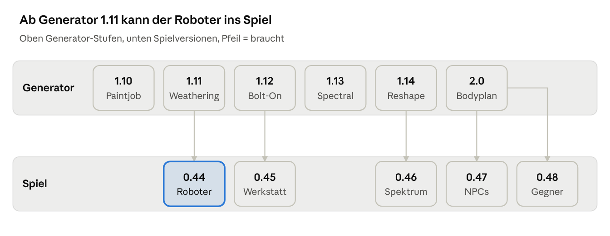

<!-- Abbild des Claude Docs „Fahrplan Roboter-Generator“. Führend ist das Doc:
https://claude.ai/code/artifact/ed285e14-821e-4986-8b02-3a281874174a – Änderungen dort vornehmen und hier nachziehen. -->

> **Führende Fassung:** [Claude Doc „Fahrplan Roboter-Generator“](https://claude.ai/code/artifact/ed285e14-821e-4986-8b02-3a281874174a).
> Diese Datei ist ein Abbild (Stand 13.10.2026, Generator 1.11.0).

# Fahrplan Roboter-Generator

2026-10-12 · @Fabian

Der Roboter-Generator wird vom Einzel-Look zum Skin-Baukasten: 64 Skins aus vier Konzeptbildern entstehen aus wenigen Systemen als Daten, danach kommt der Roboter ins Spiel, später NPC- und Gegner-Roboter.

## Ausgangslage

Der Generator kann heute einen humanoiden Roboter in vielen Varianten; im Spiel läuft noch das alte Modell, und die Konzeptbilder verlangen vor allem neue Oberflächen.

| Bereich | Stand heute | Was die Konzeptbilder zusätzlich zeigen |
|---|---|---|
| Generator 1.6.0 (`CubeEscape-Robot`, ohne Git) | 1 humanoider Körper, 28 Bones, 65 Animationen, 20 Skins (nur Farben), 28 Augen, 16 Display-Motive, 20 Accessoires, 13 Robotertypen, Robot Viewer, QA, FBX | 74 Skin-Konzepte auf drei Bögen, neue Gesichter, Skizzen- und Silhouetten-Bögen |
| Spiel (main 0.43.7) | Altes Blender-Modell, prozedural bewegt (`RobotAnimator`); M-4 und `InactiveRobot` nutzen dasselbe Modell | Gefahren nur als `HazardDevice`, keine Gegner-Roboter |
| NPC-Roboter | Nur M-4 | Drohne, Wartungs-Stelzer, Worker, Terminal-Bot, Research-Kugel, Scavenger-Vierbeiner |
| Gegner | Gefahren ohne Körper | Laser Turret, Patrol Bot, Flying Drone, Spider Bot, Rolling Bot, Trap Unit |
| Gesichter | 28 Ausdrücke | Schaden (X), Niedrige Energie, Rätsel gelöst (Haken), orange Warnung, Blinzeln |

Die Konzeptbilder sind gemalt und sehr detailliert; sie dienen nur als Ideengeber. Die Skins entstehen im bisherigen Low-Poly-Stil des Generators.

## Leitplanken

Alles folgt den Regeln aus `AGENTS.md`; diese prägen den Fahrplan besonders.

- **Der bisherige Stil bleibt.** Gebaut wird im Stil von Generator 1.6: Low-Poly, klare Formen, wenige Materialien. Die Konzeptbilder liefern nur Thema, Farben, Silhouette und Leitmotiv (Kreuz, Helm, Glut …), keine Detailtreue. Pro Skin zählen zwei bis drei erkennbare Merkmale, nicht jede Schraube oder Maserung.
- **Skin = Daten.** Ein Skin ist ein Datensatz aus Palette, Oberfläche, Schichten, Abzeichen und Teilen. Keine eigenen Textursets je Skin – 40 Sätze in 2048² wären im Spiel zu viel Speicher.
- **Bausteine statt Einzelfälle.** Aufwand hängt an der Zahl der Systeme; jeder weitere Skin kostet danach Minuten.
- **IDs sind ewig.** Die 20 bestehenden Skin-Namen bleiben gültig (gespeicherte `*.robotlook.json`); Arctic, Forest, Gold, Neon, Ocean werden aufgewertet statt ersetzt. Doppelte Namen in den Konzepten (Void, Obsidian) bekommen eindeutige IDs.
- **NPCs sind nie Begleiter, keine Rätselhinweise.** Die „Drone NPC – Begleiter / Hinweise“ aus dem Konzept wird ein ortsfester Info-NPC wie M-4.
- **Gegner sind bewegte Gefahren.** Pfad und Takt kommen als Daten (Sequenzer oder Wegpunkte), keine KI-Sonderlogik; sie bleiben in der Werkbank baubar.
- **Golden Rule im Spiel.** Der neue Clip-Animator kommt neben `RobotAnimator` (beide über `IRobotMotion`), Looks im Spielstand nur mit Migration, kein Speichermüll pro Bild (Regel 33).
- **ImageMagick ausdrücklich erlaubt.** Der Generator nutzt es schon (`make_textures.py`: Gebrauchsspuren, Decals, Augen- und Display-Atlas). Es baut auch die neuen 2D-Teile: Abzeichen, Leuchtlinien-Muster, Masken der Oberflächen-Schichten, kachelbare Werkstoff-Texturen, neue Gesichter, die Skin-Bögen samt Farbpunkten und Silhouetten sowie Icons und Vorschaubilder für die Werkstatt im Spiel. Geprüft wird damit auch: Kanten, Kontrast, Lesbarkeit der Merkmale in Iso-Größe.

## Zuerst: Testzeiten

Vor jeder Skin-Arbeit werden die Testzeiten optimiert; ohne das würde jeder Lauf mit 64 Skins rund 47 Minuten nur zum Backen brauchen.

**Umgesetzt als Generator 1.8.0 „Turbo“ und 1.9.0 „Afterburner“** (Repo `cubeescape-robogen`): quick 10 s, standard 54 s, full 211 s statt rund 40 min (1.8.0: 25 s, 133 s, 655 s), Ergebnisse identisch. 1.8 backt eine zusammengefügte Kopie statt 35 Einzelobjekt-Sitzungen (Backen 50 s statt 24 min) und setzt die Skins aus sechs Backs zusammen. 1.9 verteilt QA und alle Vorschau-Renders als Arbeitspakete auf Worker-Prozesse (QA schon während des Backens) und rendert Vorschauen ohne transparente Augen und Raytracing – ein einziges transparentes Material verdoppelte jeden EEVEE-Render. Weil 1.7.0 bis 1.9.0 vergeben sind, verschieben sich die Generator-Nummern unten um drei (Paintjob wird 1.10 usw.).

**Gemessen (Lauf vom 12.10., Apple M5, Metal):** Das Backen kostet je Skin etwa 44 s (Base 20–27 s + Emission 18–20 s). Bei 20 Skins sind das rund 15 Minuten, der größte Teil des Volllaufs. ImageMagick braucht 5–10 s je Lauf, ein Schnelllauf ohne Backen etwa 12 s.

| Maßnahme | Wirkung |
|---|---|
| **Einmal backen statt je Skin:** neutrale Basis und Farbmasken einmal, Skins färben im Viewer und später in Unity per Shader um (passt zu „Skin = Daten“) | 15 min → etwa 45 s, wächst nicht mehr mit der Zahl der Skins |
| **Cache:** Eingaben hashen (Geometrie, UV, Textur-Parameter); Unverändertes wird nicht neu gebacken, gerendert oder mit ImageMagick erzeugt | Wiederholung ohne Änderung fast ohne Kosten |
| **Teststufen nach Änderung** wie in `ce-testing`: Schnell (Geometrie, Rig, QA der betroffenen Typen und Clips, ohne Backen), Standard (+ geänderte Skins und ihr Bogen), Voll nur vor Release | Alltag statt Volllauf |
| **Parallel:** QA und Renders je Typ oder Clip-Gruppe in mehreren Blender-Prozessen | Volllauf kürzer |
| **Entwicklungsauflösung:** 1024 bzw. 512 und weniger AO-Samples, 2048 nur im Volllauf | ein Viertel bzw. ein Sechzehntel der Pixel |
| **Zeiten messen:** jede Stufe ins `robot_report.json`, Budget je Stufe mit Warnung | Verlangsamungen fallen sofort auf |

**Ziele:** Schnelllauf unter 30 s, Standardlauf unter 2 min, Volllauf unter 5 min, auch mit 64 Skins.

**Im Spiel** gilt dasselbe Prinzip: Die Roboter-Integration bekommt eigene Einträge in `Tools/test_map.json`, damit die Impact-Analyse nur die betroffenen Stufen auswählt und keine volle Regression nötig ist.

## Auf einen Blick

Vor allen Stufen kommt die Testzeit-Optimierung (Abschnitt oben). Der Generator läuft vorweg; jede Spielversion startet, sobald ihre Generator-Stufe steht. 0.46 braucht neben 1.14 auch 1.13.

## Generator-Versionen

Sechs Generator-Versionen bauen erst die Skin-Systeme (1.10–1.14), dann die Körperpläne für NPCs und Gegner (2.0). Die Namen sind Vorschläge.

| Version | Inhalt | Neue Skins | Fertig, wenn |
|---|---|---|---|
| **1.10 Paintjob** | Fundament: Ordner unter Git, `*.robotlook.json` mit `formatVersion`, **Skin-Datenformat**, QA-Schnellmodus (< 2 min). Systeme: Paletten, **Abzeichen** (Warnstreifen, Kreuz, Wolke, Nummern, Biohazard, Schriftzeichen), **Leuchtlinien-Muster**. Neue Gesichter: Schaden X, Niedrige Energie, Haken, orange Warnung, Blinzeln. **Skin-Bogen-Render** im Stil der Konzeptbilder + Silhouetten (Montage mit ImageMagick). | 23 | Skin-Bogen der 1.10-Skins zeigt jedes Leitmotiv erkennbar im bisherigen Stil; QA aller Typen gegen alle 65 Clips grün |
| **1.11 Weathering** | **Oberflächen-Schichten** mit Regler 0–1 auf jedem Skin: Rost/Abnutzung, Moos, Frost, Glutrisse (leuchtend), Tarnmuster. **Werkstoffe:** Holz, Stein, Messing, Sand, Papier, Beton, Platine. | 11 | Jede Schicht auf jedem Skin kombinierbar; Bogen + Gegenüberstellung |
| **1.12 Bolt-On** | **Aufsätze** an Sockets: Astronautenhelm, Stirnlampe/Helm, Samurai-Helm, Stacheln, Ohrenkopf, Satellitenschüssel, Zahnräder, Schornstein mit Rauch, Heiligenschein, Blattspross, Linsenauge, Taschen. | 16 | Alle Aufsätze ohne Durchdringung in allen Clips (QA), Kletter-Ausblendung gepflegt |
| **1.13 Spectral** | **Spezialmaterialien:** Glas/Kristall, Hologramm, Glitch, Schillern, Skizze. **Animiert:** Regenbogen, Galaxie/Nebel. | 9 | Viewer zeigt alle; je Material eine Beschreibung fürs spätere URP-Material |
| **1.14 Reshape** | **Formvarianten** des Körpers: facettiert, durchbrochen, offene Kabel, Voxel. | 5 | Gleiche Gelenkpunkte, alle Clips laufen, QA grün |
| **2.0 Bodyplan** | **Körperpläne** neben Humanoid: Schwebend (Würfel, Kugel), Stelzen, Vierbeiner, Spinne, Rollend, Ortsfest (Turret, Terminal, Falle). Eigene Rigs und Clip-Sätze, gemeinsame Masken und Augen-Atlas. NPC-Reihe als Typen, Gegner als rote Paletten. | NPCs + Gegner | Jeder Plan im Viewer, QA je Plan gegen seine Clips grün |

**1.10 Paintjob veröffentlicht** (12.10., v1.10.0): Skins als Daten (`data/skins.json`, 38 Skins: 20 bestehende, Gold/Neon/Toxic/Ocean
aufgewertet, 18 neue), Look-Format 3, Oberflächen je Skin, 8 Abzeichen, 5 Leuchtlinien-Muster (inkl. „Gelenke“),
Zweitfarbe in 8 Lackzonen, 5 neue Gesichter, 3 animierte Display-Motive, Skin-Bogen mit Dreiviertel-Karten, Bloom und
Silhouetten, 113 UI-Icons, Viewer mit A/B-Vergleich und GIF/MP4-Export. Aus dem Konzeptvergleich vom 12.10. kamen
Zweitfarbe, Leuchtzonen an Bauteilen, größere Abzeichen-Plätze (Ohrscheibe, Brust) und die Konzept-Vorschau dazu.
Modell, QA, Clip-Daten und Typ-Maße sind identisch mit 1.9. Techniken für Cubegen: `docs/TECHNIK.md`.

**1.11 Weathering veröffentlicht** (13.10., v1.11.0): Schichten Rost, Moos, Frost, Glutrisse, Tarnung mit Regler
(normiert: Stärke = bedeckter Anteil), Werkstoffe Holz, Stein, Sand, Papier, Beton, Messing, Platine, Abnutzung je
Skin, 47 Skins (9 neue), Gegenüberstellung `Previews/weathering.png`, Look-Format 4, Viewer und Unity-Testpaket.

**1.12 Bolt-On veröffentlicht** (13.10., v1.12.0): 14 Aufsätze (Grubenhelm mit Stirnlampe, Samurai-Helm, Stacheln,
Ohren, Satellitenschüssel, Schornstein mit Rauch, Heiligenschein, Blattspross; neuer Slot Ohren mit Linsenauge,
Zahnrädern, Zifferblatt; Linsenringe, Helmring; Rucksack mit Taschen), 10 neue Robotertypen, die zusammen jeden
Aufsatz tragen – so prüft die QA jeden in allen 71 Clips, ohne Durchdringung. 62 Skins (15 neue, Forest mit Moos und
Spross), Abzeichen Stern, Zahnrad, Blatt (dritte Maske; der Viewer packt die gewählten Abzeichen je Look).
Nachschwingen für Umhang und Antenne als gebackene Federknochen, Typ-Emotes HatTip (Gentleman) und FlagWave (King),
Schornsteinrauch als Emitter-Daten. Kletter-Ausblendung um HatTip ergänzt. 1.12.1/1.12.2: Viewer-Absturz bei
Abzeichen und Ruckeln behoben.

**1.13 Spectral veröffentlicht** (13.10., v1.13.0): Spezialmaterialien Glas/Kristall, Hologramm, Glitch, Schillern,
Skizze, Regenbogen, Galaxie als Laufzeit-Effekte (Vorschau und Viewer, je eine URP-Beschreibung), 71 Skins (9 neue),
Look-Format 5. Dazu: LOD1/LOD2, Treffer-Kapseln, Servo-Ereignisse, Masken für Unity gepackt, Unity-Testpaket in einem
Start (12 s), Skills `rg-unity-testbed` und `rg-unity-integration`.
**1.14 Reshape veröffentlicht** (13.10., v1.14.0): Proportionen nach den Konzeptbildern (größerer Kopf, kräftigere
Glieder, Fugen und Schrauben, 1,38 m) und Körperformen Facettiert, Voxel, Durchbrochen, Offene Kabel als Daten (eigene
Meshes mit demselben Rig, Lochung als Formel, Kabel als Teil), 76 Skins (Pixel, Origami, Geo, Bone, Wire), Look-Format
6; QA aller Typen und Formen über alle Clips ohne Befund.

1.14.1: Viewer-Seitenleiste bleibt in ihrer Spalte. **1.15 Pack Rat** (13.10., v1.15.0): Textur-Atlas dicht gepackt
(18 % → 51 % belegt). **1.16 Crawlspace** (13.10., v1.16.0): Kriech-Clips unter der Duck-Kapsel, Animationen
nach Inhalt in zehn Kategorien. **1.17 Slimline** (13.10., v1.17.0): Optimierung ohne Modelländerung –
Ausgaben-Cache (quick warm 22 → 9–12 s), Vorschau-Skins aus `Textures/` in den Cache, Viewer-Daten rund dreimal
kleiner, Voxel-Form mit einem Drittel weniger Dreiecken, Zeitband statt festem Budget, Generator in 16 Module aufgeteilt.
**1.19 Longstride** (14.10., v1.19.0): zwölf Clips im Spieltempo
für Cube Escape 0.58 – Jog 5 m/s, SprintFull 8 m/s, StrafeLeft/StrafeRight und RunBack 5 m/s, Wade 4 m/s, CrawlFast
2,4 m/s auf Händen und Knien unter 0,60 m, CarryIdle/CarryWalk mit der 0,8-m-Kiste, Crank am Ventilrad, Knockback und
LandRoll; gesetzte Kontakte rutschen nicht (jeder Frame-Schritt geprüft). **1.20 Powdercoat** (14.10., v1.20.0):
Oberfläche „Standard“ matt für alle Skins (wie bisher „Matt“, passend zur dunklen Station), der frühere Glanz bleibt
als neue Oberfläche „Lack“ wählbar, „Matt“ eine Stufe matter. 1.20.1: schneller Prüfweg für reine Datenänderungen;
1.20.2: ein Cache für alle Checkouts (neuer Worktree ab dem ersten Lauf warm), Prüfplan aus dem Diff
(`scripts/testplan.py`), schwere Schritte pausieren andere Sitzungen selbst. Als Nächstes 2.0 Bodyplan.

1.13.1–1.13.3: Prüfungen parallel (`check_output.sh`), QA-Cache und Render-Cache – mit warmem Cache Standardlauf
etwa 45 s, Volllauf 90–115 s statt rund 7 Minuten; eine sichtbare Änderung rendert nur ihre eigenen Bilder neu.

## Spiel-Versionen

Fünf Spielversionen holen den Roboter ins Spiel; jede ist für sich spielbar. Die Nummern werden beim Start vergeben (je Auftrag Minor +1), hier gezählt ab 0.44.

| Version | Inhalt | Braucht | Fertig, wenn |
|---|---|---|---|
| **0.44 Spieler-Roboter** | FBX-Import per Builder in der Testkopie. `RobotClipAnimator` neben `RobotAnimator`, beide über `IRobotMotion`. **Roboter-Shader** (URP) für Masken, Schichten, Abzeichen, Leuchtlinien. Clips an 5/8 m/s angepasst, Schritte und Landung über `GameEvents`. Gesichter folgen dem Spiel (Schaden, Integrität, Rätsel gelöst) per Material-Offset ohne Müll pro Bild. Kollision an der Silhouette, Ego zeigt nur Hände, Werkzeug, Schatten. | Generator 1.11 | PlayMode-Stufen Bewegung, Sprung, Ducken, Portale, Gefahren, Hauptmenü grün; Screenshots Iso + Ego; Messsonde ohne neue Ruckler |
| **0.45 Werkstatt** | Look im Spielstand (`SaveData.CurrentVersion` +1, Migration, neue Fixture). Werkstatt im UI-Standard 0.41: Typ, Skin, Schichten, Teile, Accessoires, Augen- und Displayfarbe, Drehteller. Freischalten optional über Discoveries/Flags. | Generator 1.12 | Look überlebt Speichern/Laden und Migration; Screenshots der Werkstatt |
| **0.46 Spektrum** | Spezialmaterialien und Formvarianten als URP-Materialien bzw. Meshes, mit Fallback für niedrige Grafikstufen. | Generator 1.13 + 1.14 | Alle Skins im Spiel per Screenshot geprüft, Leistung im Performance-Monitor unauffällig |
| **0.47 NPC-Roboter** | M-4 und `InactiveRobot` aus dem Generator (gleiche IDs). NPC-Roboter als Deko- und Dialog-Bausteine der Werkbank (Whitelist, Level-Format mit Migration). Keiner folgt dem Spieler. | Generator 2.0 | Bestehende Story unverändert spielbar; neue Bausteine in der Werkbank |
| **0.48 Roboter-Gefahren** | Turret und Falle als Modelle bestehender Gefahren. Neu: **bewegte Gefahr** mit Pfad und Takt (Sequenzer oder Wegpunkte) für Patrol, Drohne, Spinne (auch an Wänden), Rolling Bot. Warnungen, Gefahren-Testanlage wie H-1. | Generator 2.0 | Testanlage grün, vorhersehbares Verhalten, baubar in der Werkbank |

## Zusätzliche Aufgaben

Neunzehn weitere Punkte (zwei Vorschläge vom 12. Oktober 2026 wurden in Generator 1.9.2 geprüft und verworfen; fünf kamen aus dem Konzeptvergleich in 1.10 dazu), jeweils der Stufe zugeordnet, in der sie am besten mitlaufen.

- [x] **UI-Icons per ImageMagick** je Accessoire, Skin und Ausdruck, direkt verwendbar für ein Anpassungsmenü im Spiel – umgesetzt in Generator 1.10 (113 Icons, dazu Display-Motive und Abzeichen), genutzt in Spiel 0.45
- [x] **Detailstufen (LOD):** vereinfachte Meshes mit etwa 6 000 und 2 500 Dreiecken für Entfernung und Menge – umgesetzt in Generator 1.13 (`LOD/`, je Typ)
- [x] **Treffer-Kapseln pro Knochen** als Daten für Treffererkennung und eine spätere Ragdoll – umgesetzt in Generator 1.13 (`hitCapsules`, im Unity-Testpaket geprüft), genutzt ab 0.48
- [x] **Animierte Display-Motive** wie Herzschlag, Ladekreisel, Sprechen als Flipbook-Atlas – umgesetzt in Generator 1.10 (Heartbeat, Spinner, Talk)
- [x] **Abnutzungsstufen** von sauber bis verbeult als Masken-Kanal – umgesetzt in Generator 1.11 (Regler 0 sauber, 0,5 gebacken, 1 verbeult)
- [x] **Typ-eigene Emotes:** Gentleman lüftet den Hut, King schwenkt die Fahne – umgesetzt in Generator 1.12 (HatTip:
  der Hut reitet auf der Hand; FlagWave; je Typ in `robotTypes[].emote`, QA nur mit dem eigenen Typ)
- [x] **Nachschwingen** für Umhang und Antenne – umgesetzt in Generator 1.12 (gebackene Federknochen `Cape`,
  `Antenna`, Fahrtwind in den Lauf-Clips)
- [x] **Servo-Geräusch-Ereignisse** aus der Gelenkgeschwindigkeit berechnet (in die Clip-Daten wie die Fußschritte) – umgesetzt in Generator 1.13 (`clips.<Name>.servo`)
- [x] **Viewer:** GIF- oder Video-Export und A/B-Vergleich zweier Looks – umgesetzt in Generator 1.10 (GIF und MP4, auch per Kommandozeile)
- [x] **Unity-Testpaket** in einem separaten, leeren Unity-Projekt; das Spiel bleibt unberührt – umgesetzt in Generator 1.10.1 (`unity/run_testbed.sh`: 20 Prüfungen, 8 EditMode-Tests, Screenshots aller Skins und Typen); fand gleich einen Fehler: der Roboter schaute in Unity nach −Z
- [x] **Verworfen in 1.9.2: Visuelle Prüfung aller Kombinationen auf der Neural Engine:** Typ × Skin × Ausdruck per `RobotViewer --snapshot` rendern und mit Apples Bilderkennung (Vision, Merkmalsvergleich) gegen Referenzbilder prüfen; verzeiht kleine Pixelabweichungen aus nicht reproduzierbarem UV-Packing, findet echte Ausreißer in Millisekunden je Bild – ab der Stufe Paintjob, zusammen mit dem Skin-Bogen-Render. Geprüft in 1.9.2: kein Mehrwert – die Renders sind über Prozesse hinweg bitnah gleich (Pixel-RMSE 1e-5), ein exakter Pixelvergleich genügt; Feature Prints trennen eine fehlende Hand (0,106) kaum von 12 statt 24 Samples (0,061) und liefern je Gerät andere Abstände (Neural Engine 0,0026, CPU 0,0003), taugen also nicht als Prüfschranke
- [x] **Verworfen in 1.9.2: Weathering- und Paintjob-Vorlagen per Bildgenerator** (Core ML auf der Neural Engine) nur als einmaliges Vorlagenwerkzeug, Ergebnisse eingecheckt – nie im Generatorlauf, weil gleiche Eingabe nicht dasselbe Bild garantiert und Cache-Schlüssel reproduzierbar bleiben müssen; Stil-Abnahme vorher; passt zur Stufe Weathering. Geprüft in 1.9.2: kein Einsatz – die Vorlagen entstehen reproduzierbar per ImageMagick im Low-Poly-Stil und hängen im Cache-Schlüssel; ein Bildgenerator (mehrere GB Modell, Lizenz- und Stilprüfung) liefert das nicht
- [x] **Konzeptbögen auswerten:** umgesetzt in Generator 1.10 ohne Neural Engine – `scripts/concept_palettes.py` liest die vier Farbpunkte aller 42 Karten der Bögen A und C an vermessenen Positionen aus (`data/concept_palettes.json`), Namen abgetippt; innerhalb der Zeitregel (eine Sitzung)
- [x] **Icon-Lesbarkeit prüfen:** umgesetzt in Generator 1.10 ohne Neural Engine – Füllgrad und Lage des Motivs je Icon per ImageMagick (unter 1 s, nur Hinweis im Bericht); ein Saliency-Modell war nicht nötig
- [x] **Proportionen des Basismodells** (Konzeptvergleich 12.10.): gedrungener, größerer Kopf, klobigere Platten, Fugen und Schrauben wie auf den Konzeptbildern – umgesetzt in Generator 1.14 (Umformung je Knochen nach dem Bauen, Gelenke und Clips unverändert, zehn Posen angepasst; Standhöhe 1,38 m statt 1,30 m – Spiel-Kapsel ist eine Design-Entscheidung)
- [x] **Textur-Atlas besser nutzen:** die UV-Inseln belegten nur ≈ 18 % des 2048²-Atlas – umgesetzt in Generator 1.15 (dicht gepackt, ≈ 51 %, etwa 1,7-mal so viele Texel je cm)
- [x] **Spielkapsel und Ducken** (Entscheidung 13.10.): Kapsel stehend 1,40 m statt 1,20 m – umgesetzt in Cube Escape 0.52 „Tall Order“; Duck-Kapsel bleibt 0,65 m (Kriech-Clips in Generator 1.16), Augenhöhe für die Ego-Kamera in `robot_config.json` › `eyeHeight`
- [x] **Kriech-Clips Crawl und CrawlIdle** unter 0,65 m für Lüftungsschächte – umgesetzt in Generator 1.16 (≈ 0,57 m, ≈ 0,30 m/s, QA aller Typen und Formen grün)
- [x] **Animationen nach Inhalt sortiert** (Hinweis 13.10.) – Generator 1.16: zehn Kategorien statt Bau-Phasen
- [x] **Abnutzung je Skin** statt für alle Skins gleicher Schmutz und Kratzer (Konzeptvergleich 12.10.) – umgesetzt in Generator 1.11 (`wear` je Skin)
- [x] **Masken für Unity packen:** Lackzonen und Gelenke als ID-Kanal, Masken in 1024² (der Viewer packt schon beim Laden) – umgesetzt in Generator 1.13 (`Textures/Unity`, Testbett-Shader nutzt sie)
- [ ] **Bloom im Spiel:** URP-Bloom so, dass nur Emission strahlt (wie auf den Skin-Karten) – Spiel-Roboter
- [ ] **Cubegen übernimmt die Techniken** aus `docs/TECHNIK.md` im Robogen-Repo (Checkliste dort: Looks als Daten, Masken, Zonen, Decal-Anker, Präsentationskarten, Icons, Vorschau-App) – vorerst nur in Robogen verzeichnet, Übertrag bei einer späteren Cubegen-Version

## Skin-Katalog

Die 74 Konzepte ergeben 64 Skins, weil ähnliche zusammengelegt sind; jeder Skin steht in der Stufe seines anspruchsvollsten Systems. Bilder: **Ü** Konzeptübersicht, **A** Bogen mit 18, **B** Bogen mit 24, **C** „Neue Skin-Konzepte“ mit 24.

| Skin | Bild | Systeme | Stufe | Startset |
|---|---|---|---|---|
| Cover (= Classic) | Ü | Palette | 1.10 | ja |
| Shadow / Stealth | Ü, B | Palette, Oberfläche Matt | 1.10 | ja |
| Hazard | B | Abzeichen Warnstreifen | 1.10 | ja |
| Medic | A | Abzeichen Kreuz | 1.10 | ja |
| Volt | B | Leuchtlinien | 1.10 | ja |
| Gold / Golden (bestehend) | B, C | Palette, Oberfläche Glanz | 1.10 | ja |
| Candy | C | Palette, Oberfläche Candy | 1.10 | ja |
| Industrial | Ü | Palette, Abzeichen | 1.10 |  |
| Prototype | Ü | Palette, Abzeichen | 1.10 |  |
| Neon (bestehend) | Ü | Leuchtlinien | 1.10 |  |
| Retro / Retro 80s | Ü, B | Kopf Boxy, Antenne, 8-Bit-Display | 1.10 |  |
| Orbit | B | Palette, Antenne | 1.10 |  |
| Bolt | B | Abzeichen Streifen | 1.10 |  |
| Lab | B | Abzeichen Nummer | 1.10 |  |
| Nimbus | B | Abzeichen Wolke | 1.10 |  |
| Toxic | C | Abzeichen Biohazard, Leuchtlinien | 1.10 |  |
| Arc | A | Leuchtlinien Ringe | 1.10 |  |
| Lumin | C | Leuchtlinien Ringe | 1.10 |  |
| Cobalt | B | Palette, Leuchtlinien | 1.10 |  |
| Ocean (bestehend) | A | Palette, Leuchtlinien | 1.10 |  |
| Crimson | B | Palette | 1.10 |  |
| Chrome | B | Palette, Oberfläche Chrom | 1.10 |  |
| Tank | A | Typ Heavy, Palette | 1.10 |  |
| Rust / Scrap / Junk | Ü, A, B | Schicht Rost | 1.11 | ja |
| Moss | A | Schicht Moos | 1.11 | ja |
| Arctic (bestehend) | B | Schicht Frost | 1.11 | ja |
| Inferno / Ember | A, B | Schicht Glutrisse | 1.11 | ja |
| Circuit | C | Werkstoff Platine, Leuchtlinien | 1.11 | ja |
| Magma (Obsidian aus C) | C | Schicht Glutrisse, dunkle Palette | 1.11 |  |
| Sand | B | Werkstoff Sand, Abnutzung, Schal | 1.11 |  |
| Bamboo | C | Werkstoff Holz, Moos | 1.11 |  |
| Temple | B | Werkstoff Stein, Abzeichen Gravur | 1.11 |  |
| Paper | C | Werkstoff Papier | 1.11 |  |
| Concrete | C | Werkstoff Beton | 1.11 |  |
| Miner | A | Stirnlampe, Helm, Abnutzung | 1.12 | ja |
| Samurai | A | Samurai-Helm, Abzeichen Schriftzeichen | 1.12 | ja |
| Steam | C | Messing, Schornstein mit Rauch | 1.12 | ja |
| Signal | B | Satellitenschüssel | 1.12 | ja |
| Wood | A | Holz, Blattspross | 1.12 | ja |
| Celest | C | Heiligenschein, Abzeichen Stern | 1.12 | ja |
| Astronaut | A | Helmring, Rucksack | 1.12 |  |
| Scout | A | Tarnmuster, Taschen | 1.12 |  |
| Spike | A | Stacheln, Rost | 1.12 |  |
| Observer | A | Linsenauge | 1.12 |  |
| Clockwork | A | Messing, Zahnräder | 1.12 |  |
| Chrono | C | Messing, Zifferblatt, Linsenaugen | 1.12 |  |
| Vertex | B | Ohrenkopf | 1.12 |  |
| Obsidian | B | Ohrenkopf, dunkle Palette, Leuchtlinien | 1.12 |  |
| Forest (bestehend) | B | Moos, Blätter | 1.12 |  |
| Arbor | C | Holz, Moos, Blätter | 1.12 |  |
| Glass / Crystal | Ü, A | Glas/Kristall | 1.13 | ja |
| Ghost / Holo | A, C | Hologramm | 1.13 | ja |
| Aurora | B | Schillern | 1.13 | ja |
| Rainbow | C | animiert | 1.13 | ja |
| Prism | B | Glas/Kristall, Ohrenkopf | 1.13 |  |
| Ice | C | Glas/Kristall, Frost | 1.13 |  |
| Void | B | Glitch | 1.13 |  |
| Nebula / Void (Galaxie) | C | animiert Galaxie | 1.13 |  |
| Scribble | C | Skizzen-Material | 1.13 |  |
| Pixel | A, C | Voxel-Form | 1.14 | ja |
| Origami | C | facettiert | 1.14 | ja |
| Geo | C | facettiert, Leuchtlinien | 1.14 |  |
| Bone | C | durchbrochen | 1.14 |  |
| Wire | C | offene Kabel | 1.14 |  |

## Startset

Zuerst 24 Skins, in denen jedes System mindestens einmal vorkommt; die übrigen 40 folgen danach als reine Daten ohne neuen Code.

| Stufe | Startset-Skins |
|---|---|
| 1.10 | Cover, Shadow, Hazard, Medic, Volt, Gold, Candy |
| 1.11 | Rust, Moss, Arctic, Inferno, Circuit |
| 1.12 | Miner, Samurai, Steam, Signal, Wood, Celest |
| 1.13 | Glass, Ghost, Aurora, Rainbow |
| 1.14 | Pixel, Origami |

Ein Lieblings-Skin aus einer späteren Stufe kann als Vorschau vorgezogen werden, etwa Samurai oder Glass.

## Aufwand

Insgesamt etwa 11–16 Arbeitssitzungen bis alle Skins im Spiel sind, gemessen an Versionen wie Generator 1.6; NPC-Körperpläne und Gegner kommen danach dazu.

| Teil | Sitzungen |
|---|---|
| Zuerst: Testzeiten (Einmal-Backen, Cache, Teststufen, Messung) | 1 |
| Generator 1.10 Paintjob (inkl. Fundament) | 1 |
| Generator 1.11 Weathering | 1–2 |
| Generator 1.12 Bolt-On | 1–2 |
| Generator 1.13 Spectral | 1–2 |
| Generator 1.14 Reshape | 1–2 |
| Spiel 0.44 Spieler-Roboter (Shader, Import, Clip-Animator) | 2–3 |
| Spiel 0.45 Werkstatt + Migration | 1–2 |
| Spiel 0.46 Spezialmaterialien | 1–2 |
| Generator 2.0 + Spiel 0.47/0.48 (NPCs, Gegner) | noch nicht geschätzt |

Der schwerere Teil ist Unity: Was der Viewer zeigt, muss im Spiel genauso aussehen, ohne Ruckler, in Iso und Ego. Eine volle Generator-Runde dauert seit 1.9 rund 3,5 Minuten.

## Entscheidungen

- [x] **Startset:** so übernommen (12.10.). Jede Stufe hat damit genau die Skins, an denen ihr System geprüft wird; die Favoriten Samurai und Glass sind schon dabei.
- [x] **Wo lebt der Generator?** Im eigenen GitHub-Repo `ffunkfabian-hash/cubeescape-robogen` (seit 1.7.0).
- [x] **Doppelte Namen:** Galaxie geht in Nebula auf, Magma heißt Magma; Void (Glitch, B) und Obsidian (B) behalten ihre Namen.
- [x] **Reihenfolge:** erst der Spieler-Roboter, dann NPCs und Gegner – wie in den Spiel-Versionen oben.
- [ ] **Gegner – zurückgestellt bis vor Generator 2.0:** Empfehlung bleibt das feste Muster: Pfad und Takt als Daten (Sequenzer, Wegpunkte), vorhersehbar, in der Werkbank baubar und für jede Levelgröße gleich billig. Echte Verfolger bräuchten eine Navigation zur Laufzeit über Spielerlevel aus JSON (bis 100 000 Objekte) und machen Rätsel unberechenbar; sie lohnen nur, wenn Verfolgung selbst zur Spielidee wird.
- [x] **Tempo, Kapselbreite, Augenhöhe** (14.10., Cube Escape 0.57): Das Spieltempo 5/8 m/s bleibt (Level sind darauf gebaut); bis längere Schritte kommen, läuft die Animation mit Geschwindigkeit / `naturalSpeed`, höchstens 1,4-fach, und eine Generator-Version gibt Run und Sprint Schrittlängen für 5 und 8 m/s – erledigt mit 1.19 „Longstride“ (Jog, SprintFull und weitere Clips bei Tempo 1). Die Kapsel behält Radius 0,30 m (ein breiterer schlösse Durchgänge in bestehenden Leveln), Überstand von Armen und Schultern ist in Ordnung. Die Ego-Kamera übernimmt `eyeHeight` (1,16 m) mit dem Spieler-Roboter.
- [x] **Alter Stand gesichtet (12.10.):** Der Branch `claude/cube-escape-robot-model-04030e` hatte keine eigenen Commits (Spitze = Cube Escape 0.43.2, in main) und keinen Worktree mehr. Gearbeitet wurde im Ordner `CubeEscape-Robot`, der vollständig als 1.7.0 ins Repo übernommen ist (Unterschied nur die Bildpfade im README). Nichts entsteht doppelt; Branch gelöscht, Ordner in den Papierkorb verschoben (12.10.).
- [ ] **Freischalten** von Skins im Spiel: alle sofort frei oder über Discoveries/Flags? Fabian entscheidet später, spätestens zur Werkstatt-Version.
